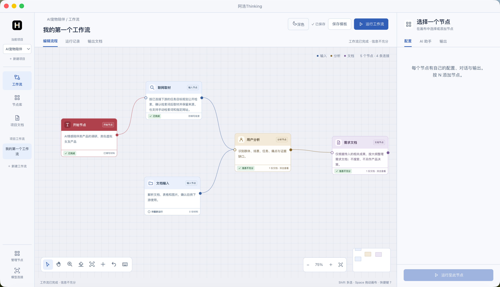
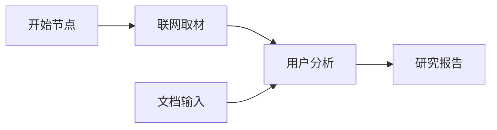
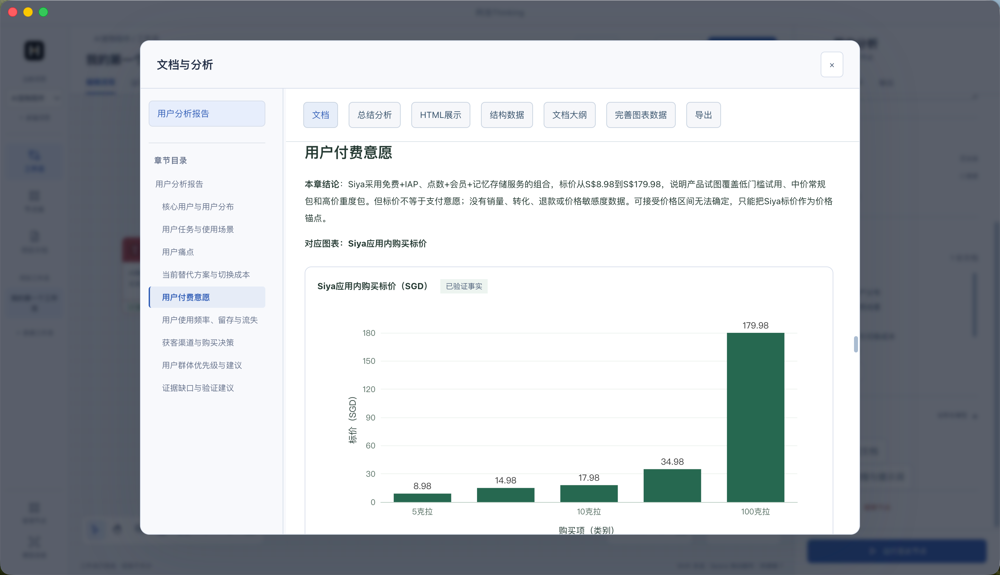

<p align="center">
  
</p>
<h1 align="center">阿浩Thinking</h1>
<p align="center"><strong>把想法、资料和分析，连接成可交付的产品文档。</strong></p>
<p align="center">产品经理桌面工作台 · 节点工作流 · 专业分析与报告 · 本地保存</p>
<p align="center">
  <a href="https://github.com/Hao2048/haohao-product-workbench/releases/latest">下载 macOS 版</a> ·
  <a href="#快速开始">快速开始</a> ·
  <a href="#节点工作流">节点工作流</a> ·
  <a href="#资料缺口与补齐">资料缺口与补齐</a> ·
  <a href="#文档与图表">文档与图表</a> ·
  <a href="apps/workbench/nodes/README.md">节点开发指南</a>
</p>



阿浩Thinking 是基于 **DeepSeek Harness SDK** 的个人 macOS 产品工作台。你可以从一个想法、一份材料或一组业务数据开始，把收集、分析和报告整理成可重复使用的节点流程。

它把工作分成三个明确的职责：**输入节点提供材料，分析节点形成判断，文档节点组织交付。** 各节点沿连线接收上游数据，保留来源、假设和待确认事项；报告生成结束，不代表产品假设已经被验证。

当前版本为 **v2.9.0**，主要开发和验证环境为 **macOS Apple Silicon**，要求 macOS 13 或更高版本。可从 [最新发布](https://github.com/Hao2048/haohao-product-workbench/releases/latest) 下载桌面安装包，也可以从源码构建。当前安装包使用本地开发签名，尚未进行 Apple Developer ID 公证。

> 两张截图由维护者提供，来自实际桌面界面，用于展示节点编排、文档阅读和图表。截图中的研究结论属于示例项目内容，不代表已经验证的市场事实；“信息不充分”表示该次输出保留了证据缺口。

## 可以做什么

| 工作场景 | 处理方式 | 典型产出 |
| --- | --- | --- |
| 判断一个产品方向 | 收集公开资料，分别分析市场、用户、机会与风险 | 研究报告、机会判断、验证建议 |
| 准备立项 | 结合研究成果、目标、资源和约束进行论证 | 立项报告，含 MVP 简介 |
| 明确第一版范围 | 分析核心问题、闭环、优先级与验证目标 | 完整 MVP 方案、需求文档 |
| 细化产品设计 | 将确认的范围转为功能、规则、交互与流程 | PRD、交互原型方案、业务与交互流程 |
| 准备上线验收 | 围绕业务目标设计事件、指标和验收要求 | 埋点方案、验收清单 |
| 分析实际业务数据 | 先用代码计算，再由 AI 解读结果 | 转化漏斗、使用与留存、A/B 实验分析报告 |
| 制订下一步行动 | 汇总分析发现、验证结果与待处理问题 | 迭代计划与复盘分析 |

**需求文档与 PRD 是两个独立产出。** 立项报告中的 MVP 只作简介；完整的 MVP、PRD 和原型需要对应节点继续处理。分析节点自身也可以产生分析文档，不必每次都额外连接报告节点。

模型和检索服务需要可用的连接；访谈、内部业务数据和实际验证结果需要自行提供。工作台不会凭空生成真实用户证据。

## 快速开始

### 1. 安装或从源码启动

**直接使用桌面版：**

1. 从 [v2.9.0 发布页](https://github.com/Hao2048/haohao-product-workbench/releases/tag/v2.9.0) 下载 `ahao-thinking-2.9.0-mac-arm64.dmg`。
2. 打开 DMG，将“阿浩Thinking”拖入“应用程序”。升级前先退出旧版应用，保留原有资料目录。
3. 启动应用；如出现钥匙串授权窗口，在系统窗口完成授权。安装包内置运行环境，无需另装 Node.js 或使用浏览器。

安装、校验与升级说明见 [macOS 安装指南](docs/INSTALL-macOS.md)。当前仅提供 Apple Silicon 安装包，Intel Mac 用户需自行构建并验证。

**从源码开发：**

需要 Node.js **24+**、Git、npm，以及可用的模型账号或 API Key。macOS 构建还需安装 **Xcode Command Line Tools**；首次安装依赖需要联网。

```bash
git clone --recurse-submodules https://github.com/Hao2048/haohao-product-workbench.git
cd haohao-product-workbench
node scripts/setup-workbench.mjs
cd apps/workbench
npm run desktop:dev
```

初始化脚本会安装上游固定版本的 pnpm 依赖、构建 Harness 原生模块与 SDK，再安装工作台依赖并生成离线图表资源。无需另行全局升级 pnpm。上游子模块固定在提交 `5badb15009ae1756c3afe0ae0cef1faafc290ccc`。

### 2. 接入模型

打开 **模型连接**，选择厂商、填写 API Key，保存并测试连接。预设包含 DeepSeek、OpenAI、Anthropic、通义千问、Kimi 和智谱 Coding Plan 入口。

内部服务或自定义模型可在高级设置填写模型 ID、Base URL 和接口协议。节点可以使用项目默认模型，也可在配置中选择独立模型。

预设入口不保证账号拥有相应模型或套餐权限；智谱 Coding Plan 的使用范围需以提供商要求为准。模型调用费用由相应服务商收取。

### 3. 写清工作方向

新建项目和工作流，在红色的 **开始节点** 中写清楚：

- 做什么产品或研究什么方向。
- 面向谁、解决什么问题。
- 这次希望得到什么结果，以及已知约束。

每个工作流固定一个开始节点，不能另建或删除。它是文字输入起点，背景沿连线传递，不会自动传播给没有连接的节点，也不作为已验证证据。

可以用这段内容开始：

> 我想研究面向经常独处上班族的 AI 宠物陪伴产品，考虑手机与电脑之间延续陪伴体验。本轮先识别典型场景、痛点和现有替代方案，不预设需求已经成立。请区分公开资料、分析推断和待验证假设。

### 4. 连接节点并运行

先搭一条简单链路：



文档输入是可选补充，可上传访谈、用户反馈或竞品笔记。选中节点，在右侧配置任务、材料、模型及大纲，再运行整个工作流或“运行至此节点”。

联网取材可以参考下游任务规划检索方向，也支持手动检索词和指定网址。运行前确认要公开提交的检索词；可使用内置检索，或在连接设置中配置 Tavily、Brave、SearXNG。访问限制、验证页面和服务状态都可能影响取材结果。

### 5. 查看与继续处理

运行过程中查看节点状态、AI 助手的流式输出和澄清问题。双击已有文档的节点，或从 **输出文档** 打开报告；检查结论、来源、图表和证据缺口，再决定补充材料或连接下一步分析。

建议先跑通一条小流程，确认输入和输出符合预期后，再扩展到立项、需求、PRD、验收及迭代。

## 节点工作流

当前内置 **31 个节点**，统一在 [`apps/workbench/nodes/`](apps/workbench/nodes/) 中维护。

| 类型 | 数量 | 职责与能力 |
| --- | --- | --- |
| 输入节点 | 5 | 开始节点、文字输入、文档输入、联网取材、已有产物引用 |
| 分析节点 | 15 | 市场、用户、机会与风险、立项论证、需求洞察、MVP、PRD、原型、流程、埋点、验收、漏斗、使用与留存、A/B 实验、迭代复盘 |
| 文档节点 | 11 | 研究报告、立项报告、需求文档、MVP 方案、PRD、交互原型、业务与交互流程、埋点方案、验收清单、数据分析报告、迭代计划 |

节点类型与端口决定哪些数据可以连接，运行前还会检查材料是否适合当前任务。**端口能连上，不等于材料足以完成任务。** 例如用户研究材料可以帮助明确 MVP，但不能代替产品目标、资源约束和范围决定。

- 每个节点有自己的配置、对话、运行状态与输出，可清空当前节点上下文。
- 管理节点中可以查看工作步骤、职责和完整提示词。
- 运行按依赖顺序执行，相关上游成功后才向下游交接数据。
- 配置、上游结果、模型或节点规则变化会影响结果复用；联网和历史产物引用会重新读取。
- 画布支持拖动、缩放、打组、底色调整、缩略图及快捷键，提供深色与银白两套主题。

节点职责保持分离：联网节点收集公开资料，分析节点提出有证据边界的判断，文档节点只编排传入的相关成果，不能自行搜索或替用户作产品决策。

## 资料缺口与补齐

v2.9.0 将关键缺口检查放在分析和报告生成之前，避免直到读完文档才发现重要材料缺失。

| 缺口 | 例子 | 处理方式 |
| --- | --- | --- |
| 公开资料 | 竞品功能、公开定价、产品说明 | 确认检索词后，交给已连接的上游联网节点补齐 |
| 产品决策 | 首发平台、目标群体、MVP 边界 | 用户填写并确认，沿连线传给下游 |
| 真实证据 | 访谈样本、真实留存、付费转化 | 提供材料或标记待验证，不能用搜索结果替代 |
| 阶段不适用 | 未上线产品的实际留存率 | 说明当前阶段与理由，改为后续验证事项 |

运行前面板支持批量补充，也可明确选择保留缺口生成草稿。非关键细节与阶段不适用事项不会机械地阻塞任务；完全不相关的报告材料会直接拒绝，统计数据格式错误不能用草稿跳过。

公开资料补齐只委托**已有连接的上游搜索节点**，不会给报告节点增加联网权限，也不会创建隐藏节点。每次运行最多补充两轮，保留原有来源，并重跑受影响的节点；没有对应搜索节点时，需要返回配置连接或手动补充材料。

确认记录在同一工作流的相关链路中复用；改变方向或来源任务后会失效，清空来源节点上下文会移除其记录。用户陈述、已确认决策、分析推断和真实测量数据保持区分。

缺口识别仍依赖模型判断。补齐后以受影响节点为单位重新生成完整文档，尚不支持逐章节增量生成；旧报告不会自动改写。

## 文档与图表



文档以当前选中的报告为单位阅读与总结，多个产出通过左侧列表切换。

- **大纲先行**：文档节点可编辑大纲，生成时按确认后的结构组织内容。
- **章节导航**：自动从正文标题建立索引，点击跳转，阅读时高亮当前章节。
- **独立阅读区域**：左侧列表与正文分别滚动，分隔线可拖动调整宽度。
- **多种视图**：文档、当前文档的总结分析、结构数据、大纲，以及按需生成的 HTML 展示。
- **图表呈现**：统计图使用 ECharts 的 SVG 渲染，流程与关系图使用 Mermaid，支持放大与 SVG / PNG 导出。
- **图表修订**：“完善图表数据”支持表格与 JSON 编辑、来源和字段校验、预览及另存修订。
- **文档导出**：支持 Markdown、大纲和已生成的 HTML；HTML 展示默认不生成，按需调用模型。

输入支持 TXT、Markdown、CSV、JSON、PDF、DOCX、XLSX、PNG、JPG/JPEG，单文件不超过 **20 MB**。图片及扫描 PDF 的文字提取依赖 macOS Apple Vision / PDFKit OCR；解析后需确认材料再进入节点。

漏斗、使用与留存、A/B 实验节点先校验数据并用代码计算，再交给 AI 解读。缺失指标不补零、不伪造留存曲线；图表保留来源与证据性质，无法渲染时保留数据供修正。

## 添加与维护节点

节点是对专业方法、提示词或 SOP 的封装，而不只是画布上的一个名称。节点包包含定义、端口、配置字段、步骤与指令；需要自定义逻辑时可提供插件入口。

```text
apps/workbench/nodes/
├── input.start/node.json       固定起点
├── input.web/node.json         联网取材
├── analysis.user/node.json     用户分析
├── report.research/node.json   研究报告
└── local.example/              自定义节点包
    ├── node.json
    └── execute.mjs             使用插件执行器时提供
```

在节点管理中打开实际节点目录，添加或维护节点包。程序扫描有效定义后，节点库与配置面板会自动更新；通常不需要修改注册表或主界面代码。安装版使用用户数据目录中的 `nodes/`，源码中的内置节点用于初始安装与升级。

复用现有 AI 或插件执行器可以增加专业能力；引入新的系统权限或运行时仍可能需要修改主程序。代码插件以本机进程权限执行，**不是操作系统沙箱**，请只安装可信节点包。

端口约定、字段类型、插件接口和升级规则见 [节点开发指南](apps/workbench/nodes/README.md)。

## 模型、上下文与数据

- 桌面项目、工作流、模型连接与运行记录保存在 `~/Library/Application Support/AIPM Workbench`，不会存入源码仓库。
- 桌面数据通过 macOS 钥匙串支持的 Electron `safeStorage` 加密；加密不可用时拒绝启动，不回退明文。首次启动或开发签名更新可能需要完成系统授权。
- `npm start` 是本地浏览器开发入口，开发数据默认位于 `apps/workbench/data/`，不等同于桌面版的钥匙串加密存储。
- 各节点按连接接收必要材料，不把所有项目或所有节点对话混成一个全局上下文。已确认事项只在适用方向和链路中复用。
- “本地保存”不等于离线推理。发送给云端模型的材料会交给所选提供商；公开检索词会发送给相应检索服务。
- 当前没有内置离线模型，也不提供云端多人协作或跨设备同步。Windows / Linux 未做与 macOS 同等程度的桌面验证。

## 开发与构建

完成前面的初始化步骤后，在 `apps/workbench/` 下执行：

```bash
npm test                     # 单元与模拟模型集成测试
npm start                    # 本地浏览器开发入口
npm run desktop:dev          # 桌面开发模式
npm run build:visuals        # 构建离线 ECharts / Mermaid 资源
npm run desktop:package      # 构建本机架构的 macOS 应用与 DMG
```

桌面产物位于 `产品经理工作台/桌面安装包/`。当前主要验证 Apple Silicon 包；本地包使用开发签名，尚未进行 Apple Developer ID 公证。对外分发需另行完成相应发布配置。

v2.9.0 通过 **172 项自动测试**，覆盖节点与数据交接、缺口处理、计算、图表、文档导航、资源加载等。部分测试使用模拟模型和合成材料；通过自动测试不代表任意真实模型和搜索服务组合都已验证。浏览器与桌面交互回归命令见 [工作台开发说明](apps/workbench/README.md)。

| 目录 | 内容 |
| --- | --- |
| [`apps/workbench/src/`](apps/workbench/src/) | 本地服务、任务调度、Harness 接入、输入解析和统计 |
| [`apps/workbench/public/`](apps/workbench/public/) | 节点画布、配置面板、报告阅读和图表渲染 |
| [`apps/workbench/nodes/`](apps/workbench/nodes/) | 节点定义、专业步骤、提示词与流程模板 |
| [`apps/workbench/desktop/`](apps/workbench/desktop/) | Electron 主进程、加密存储、动态网页读取和更新 |
| [`apps/workbench/native/`](apps/workbench/native/) | Apple Vision / PDFKit OCR |
| [`apps/workbench/tests/`](apps/workbench/tests/) | 自动测试和界面回归脚本 |
| [`deepseek-harness/`](deepseek-harness/) | 固定版本的上游 SDK 子模块 |
| [`产品经理工作台/`](产品经理工作台/) | 产品需求、开发说明、原型与品牌资料 |

旧六阶段界面、模块接口和独立 Skill 快照已退出运行链路，专业能力维护在节点包中。历史数据迁移前会在资料目录保存原始加密备份；备份不参与当前运行，详见 [数据升级说明](apps/workbench/README.md#数据升级)。

## 状态与反馈

本项目面向个人产品工作和小型研究流程。AI 生成的分析、建议、原型和文档需要结合真实资料审阅；没有访谈、实验或业务数据时，结论应保留其假设性质。

欢迎通过 [Issues](https://github.com/Hao2048/haohao-product-workbench/issues) 提供软件版本、系统、复现步骤、预期与实际结果，以及脱敏日志。请勿提交 API Key、Cookie、完整私人材料或整个应用资料目录。

仓库不收录模型密钥、用户数据、依赖目录与安装包。本文使用的两张截图为维护者明确提供的展示素材，保存于 `docs/assets/`。

## 致谢

基于 [DeepSeek Harness](https://github.com/deepseek-ai/deepseek-harness) SDK 构建桌面工作流，使用 Electron、Node.js、ECharts、Mermaid 与 macOS 原生 OCR。DeepSeek Harness 遵循其 [MIT 许可证](deepseek-harness/LICENSE)，其他第三方依赖遵循各自许可证。
