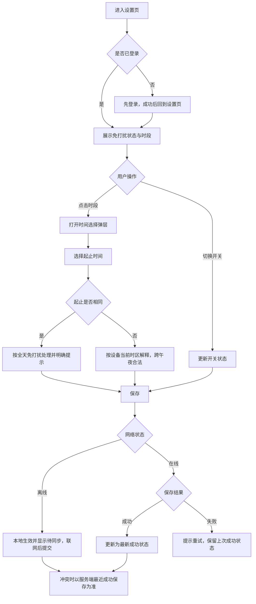
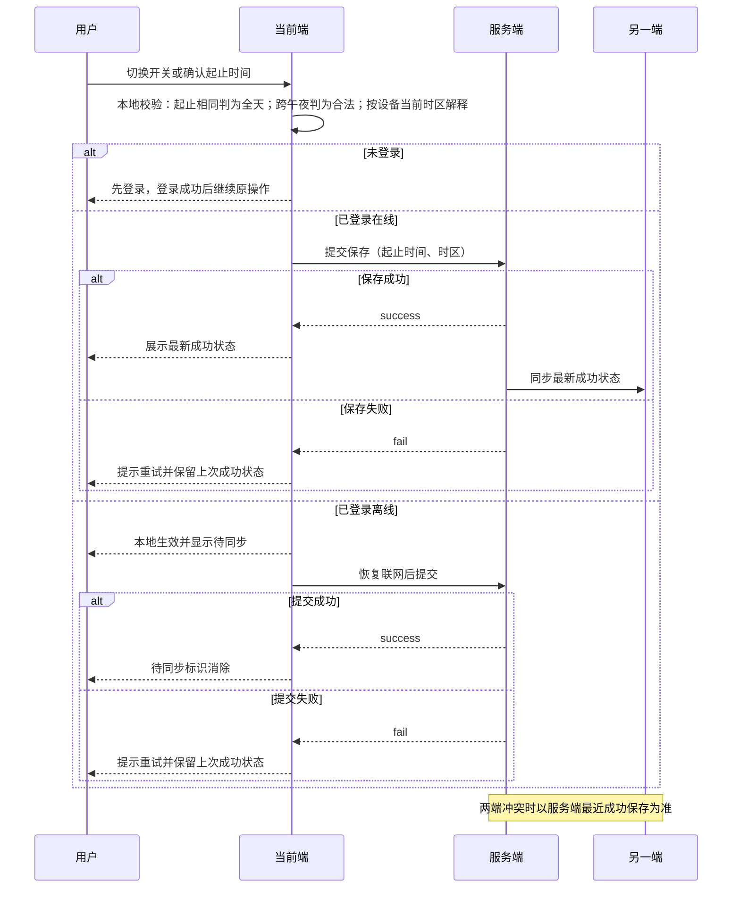

# PRD方案分析

> 材料性质：本文全部输入为软件 QA 人造测试材料（来源 S1「文字输入」，证据状态：测试数据），不构成真实市场证据或用户访谈。文中“已确认”仅指“在该测试材料中被给定的功能规格”，不代表真实业务评审已通过。本文为分析成果，不构成 PRD 已验收结论。

## 核心结论

1. **范围极小且已收敛**：仅一个设置页与一个时间选择弹层；范围外明确为多时间段、按星期、推送系统重构。测试材料同时要求不扩展社区、商业模式等内容。
2. **规则密集但边界清晰**：默认关闭、开启后默认 22:00–08:00、按设备时区、跨午夜合法、起止相同即全天、仅阻断主动问候、保存失败保留上次成功状态、未登录先登录、两端同步以服务端最近成功保存为准、离线待同步。以上均为测试材料给定输入（见 3.4 规则表 R1–R10）。
3. **主要分析风险集中在四类未覆盖点**：关闭态是否展示时段、保存失败时界面回退方式、冲突覆盖提示、时区变更后的时段解释。这些在材料中未定义，本文只作为分析推断或待确认项列出。
4. **证据等级低**：无访谈、无基线、无原型截图、人员未知。目标“主动消息投诉率”缺口径与基线，无法在本节点形成可度量目标。
5. **章节取舍**：本文不做市场规模、竞品对比、社区与商业模式延伸，不做技术接口设计；不做多时间段/按星期/推送重构的方案扩展；现有方案只描述测试版本的“无免打扰、主动问候全部直出、用户只能退出应用”。
6. **交付定位**：本文提供逐屏逐状态的页面元素、交互说明、所属边界、跨页共享规则、异常清单与埋点方案，供 PRD 报告节点整理。

## 证据与分析

### 3.1 材料与来源

| 来源 ID | 材料 | 性质 | 可用于 | 不可用于 |
| --- | --- | --- | --- | --- |
| S1 | 文字输入：宠物免打扰设置测试材料 | 测试数据（QA 人造） | 功能规格、规则与埋点字典整理；流程与状态分析 | 市场规模、用户真实意愿、上线结论、验收结论 |

缺口（本节）：仅单一来源，无访谈记录、无原型截图、无历史数据、无人员名单。

### 3.2 背景：场景问题—影响—证据

| 场景问题 | 影响 | 证据 | 证据状态 |
| --- | --- | --- | --- |
| 测试用户在工作时会被主动问候打断 | 缺少量化影响：无投诉量、无打断频次、无留存或退出数据 | S1 陈述“工作时被主动问候打断”“无实际访谈和基线” | 测试数据 |
| 当前测试版本无免打扰，主动问候全部直接展示 | 用户唯一可用手段是退出应用（材料陈述），代价为放弃使用 | S1 陈述现有方案 | 测试数据 |
| 用户无法表达可打断时段 | 缺少可控时段配置能力 | 由“页面只有设置页及时间选择弹层”的规格反推 | 分析推断 |

分析推断：打断问题的真实严重度与发生频率无法从现有材料判断，不得用任何数值替代缺失证据。

### 3.3 目标与口径

| 项 | 内容 | 状态 |
| --- | --- | --- |
| 目标 | 用户可开启免打扰并设置每日时间段；观察主动消息投诉率 | 已确认（S1 给定） |
| 目标值 | 待基线确认 | 待确认 |
| 指标分子（投诉定义） | 未定义（哪些反馈算投诉、是否含退出/卸载/客服） | 待确认 |
| 指标分母 | 未定义（活跃用户？收到主动消息的用户？） | 待确认 |
| 统计周期 | 未定义（日/周/版本前后对比窗口） | 待确认 |
| 数据来源 | 未定义；现有埋点字典中无投诉类事件 | 缺口 |
| 基线 | 无 | 缺口 |

缺失证据表（本节）：投诉率口径与基线整列缺失，无法绘制趋势或对比图，不生成任何分布、比例或留存类图形。

### 3.4 用户场景

| 场景 ID | 场景 | 前置 | 用户行为 | 期望结果 | 来源性质 |
| --- | --- | --- | --- | --- | --- |
| U1 | 工作时段避免被打断 | 已登录，免打扰默认关闭 | 开启免打扰并使用默认 22:00–08:00 或自定义时段 | 主动问候被阻断，主动聊天与喂养成长不受影响 | 测试数据 |
| U2 | 跨午夜时段 | 已开启 | 设置 22:00–08:00 | 跨午夜合法，不报错 | 测试数据 |
| U3 | 全天免打扰 | 已开启 | 起止时间设为相同 | 视为全天免打扰并有明确提示 | 测试数据 |
| U4 | 免打扰期间主动互动 | 已开启且在时段内 | 用户主动发起聊天 | 不被阻断，喂养成长不暂停 | 测试数据 |
| U5 | 离线调整 | 已登录、断网 | 修改开关或时段 | 本地可见改动并显示待同步，联网后提交 | 测试数据 |
| U6 | 两端同时修改 | 两端均已登录 | 分别修改设置 | 以服务端最近成功保存为准 | 测试数据 |
| U7 | 未登录进入 | 未登录 | 进入设置页 | 先登录再继续 | 测试数据 |
| U8 | 保存失败 | 已登录在线 | 保存 | 提示重试并保留上次成功状态 | 测试数据 |

缺口（本节）：“两端”具体指哪两端未说明；默认定时 22:00–08:00 是否在关闭态可见未说明。

### 3.5 现有方案与差距

| 维度 | 现有测试版本 | 目标规格 | 差距性质 |
| --- | --- | --- | --- |
| 主动问候控制 | 无免打扰，全部直接展示 | 可开启、可按每日时段阻断 | 功能缺失（已确认） |
| 用户应对方式 | 只能退出应用 | 应用内可控 | 已确认 |
| 时段能力 | 无 | 单个每日时段，跨午夜合法，起止相同为全天 | 已确认 |
| 多时段/按星期 | 无 | 明确不做 | 范围外（已确认） |
| 推送机制 | 未说明 | 明确不重构 | 范围外（已确认） |

### 3.6 业务规则盘点

| 规则 ID | 规则 | 类型 | 来源 |
| --- | --- | --- | --- |
| R1 | 免打扰默认关闭 | 已确认 | S1 |
| R2 | 开启后默认 22:00–08:00 | 已确认 | S1 |
| R3 | 时间按设备当前时区解释，跨午夜合法 | 已确认 | S1 |
| R4 | 起止时间相同视为全天免打扰，并给出明确提示 | 已确认 | S1 |
| R5 | 免打扰仅阻止主动问候，不阻止用户主动聊天，喂养成长不暂停 | 已确认 | S1 |
| R6 | 保存失败提示重试并保留上次成功状态 | 已确认 | S1 |
| R7 | 未登录先登录 | 已确认 | S1 |
| R8 | 两端状态同步，冲突以服务端最近成功保存为准 | 已确认 | S1 |
| R9 | 离线可改，显示待同步，恢复联网后提交 | 已确认 | S1 |
| R10 | 范围外：多时间段、按星期、推送系统重构 | 已确认 | S1 |
| R11 | 关闭免打扰后是否保留已选时段 | 待确认 | 材料未定义 |
| R12 | 保存失败时开关与时段是否回退展示上次成功值 | 待确认（A2 分析推断） | 材料未定义 |
| R13 | 冲突覆盖时是否提示用户 | 待确认（A3 分析推断） | 材料未定义 |
| R14 | 时间粒度、time_zone 字符串格式、文案与控件样式 | 待确认 | 材料未定义 |

### 3.7 埋点字典现状

| 事件 | 参数 | 触发时机 | 状态 |
| --- | --- | --- | --- |
| dnd_toggle | enabled: boolean | 未给定 | 已给定事件与参数，触发时机待确认 |
| dnd_save | start_time: string, end_time: string, time_zone: string, result: success/fail | 未给定 | 已给定事件与参数，触发时机待确认 |

缺口（本节）：无页面曝光、弹层操作、待同步、冲突覆盖、登录拦截、失败原因、投诉类事件；现有两条事件不得描述为已上线。

## 方案与规则

### 4.1 页面与边界清单

| 页面 ID | 页面 | 所属边界 | 说明 |
| --- | --- | --- | --- |
| SET-DND-01 | 免打扰设置页 | 本期范围内 | 唯一设置入口，承载开关、时段展示与状态提示 |
| DLG-DND-TIME-01 | 时间选择弹层 | 本期范围内 | 设置每日起止时间 |
| — | 推送系统改造、多时间段、按星期 | 范围外（R10） | 不在本方案内 |

品牌约束：主色 #315eb6（S1 给定）；无真实原型截图，控件形态与文案未给，属待确认。

### 4.2 逐屏/逐状态方案：SET-DND-01 免打扰设置页

| 状态 ID | 页面/状态 | 页面元素 | 交互说明 | 所属边界 | 依据 |
| --- | --- | --- | --- | --- | --- |
| S1-01 | 加载中 | 页面标题、加载占位 | 展示加载态；不提前写入默认值或上次值，避免闪现错误状态 | 本期 | 分析推断 |
| S1-02 | 未登录 | 登录引导与入口 | 先登录；登录完成后回到设置页继续 | 本期（R7） | S1 已确认 |
| S1-03 | 默认关闭（首次使用） | 免打扰开关（关闭态）、时段入口 | 默认关闭；时段入口是否展示默认 22:00–08:00 待确认 | 本期（R1） | S1 已确认＋待确认项 |
| S1-04 | 已开启 | 开关（开启态）、当前时段文本（如 22:00–08:00）、时间选择入口 | 展示当前生效时段；点击时段进入 DLG-DND-TIME-01 | 本期（R2） | S1 已确认 |
| S1-05 | 全天免打扰 | 开关（开启态）、全天标识与明确提示 | 起止相同时展示“全天”类提示文案（具体文案待确认） | 本期（R4） | S1 已确认＋待确认项 |
| S1-06 | 保存中 | 保存中提示、禁用重复提交 | 保存过程中不允许重复触发保存 | 本期 | 分析推断 |
| S1-07 | 保存失败 | 失败提示＋重试入口、上次成功状态 | 提示重试并保留上次成功状态；界面是否回退到上次成功值待确认 | 本期（R6） | S1 已确认＋待确认项 |
| S1-08 | 离线待同步 | 待同步标识、当前可编辑状态 | 允许修改并本地可见；显示待同步；恢复联网后提交 | 本期（R9） | S1 已确认（标识样式待确认） |
| S1-09 | 同步冲突 | 展示服务端最近成功保存的时段与开关 | 以服务端最近成功保存为准；是否提示被覆盖待确认 | 本期（R8） | S1 已确认＋待确认项 |
| S1-10 | 状态读取失败 | 未定义 | 材料未覆盖该场景 | 待确认 | 缺口 |

### 4.3 逐屏/逐状态方案：DLG-DND-TIME-01 时间选择弹层

| 状态 ID | 页面/状态 | 页面元素 | 交互说明 | 所属边界 | 依据 |
| --- | --- | --- | --- | --- | --- |
| S2-01 | 打开弹层 | 起始时间、结束时间、取消、确认 | 打开时带入当前时段；未修改时确认不产生变更 | 本期 | 分析推断 |
| S2-02 | 编辑中（非跨午夜） | 起止时间选择控件 | 正常选择；具体粒度（分钟/15 分钟）待确认 | 本期 | S1 规格＋待确认项 |
| S2-03 | 编辑中（跨午夜） | 起止时间选择控件 | 起 22:00、止 08:00 合法，不提示错误 | 本期（R3） | S1 已确认 |
| S2-04 | 起止相同 | 全天提示 | 给出明确提示后允许确认，确认后按全天免打扰生效 | 本期（R4） | S1 已确认（文案待确认） |
| S2-05 | 取消 | 取消按钮 | 放弃本次修改，页面保持原值 | 本期 | 分析推断 |
| S2-06 | 确认 | 确认按钮 | 写回 SET-DND-01 并触发保存流程（在线/离线分支） | 本期 | S1 规格推导 |
| S2-07 | 弹层打开时设备时区变化 | 未定义 | 材料未覆盖 | 待确认 | 缺口 |

### 4.4 跨页共享规则（集中）

| 编号 | 规则 | 适用页面 | 类型 |
| --- | --- | --- | --- |
| X1 | 免打扰默认关闭 | SET-DND-01 | 已确认（R1） |
| X2 | 开启后默认 22:00–08:00 | SET-DND-01 | 已确认（R2） |
| X3 | 时间按设备当前时区解释；跨午夜合法 | SET-DND-01、DLG-DND-TIME-01 | 已确认（R3） |
| X4 | 起止相同＝全天免打扰，必须有明确提示 | SET-DND-01、DLG-DND-TIME-01 | 已确认（R4） |
| X5 | 免打扰只阻止主动问候；用户主动聊天不阻断；喂养成长不暂停 | 全局 | 已确认（R5） |
| X6 | 保存失败提示重试并保留上次成功状态 | SET-DND-01 | 已确认（R6） |
| X7 | 未登录先登录，完成后继续原操作 | SET-DND-01 | 已确认（R7） |
| X8 | 两端同步，冲突以服务端最近成功保存为准 | 全局 | 已确认（R8） |
| X9 | 离线可改＋待同步＋联网后提交 | SET-DND-01 | 已确认（R9） |
| X10 | 主色 #315eb6；文案、字号、控件形态以设计交付为准 | 全局 | 已确认品牌色；其余待确认 |
| X11 | 关闭后保留已选时段、失败回退展示方式、冲突提示方式 | SET-DND-01 | 待确认（R11–R13） |

### 4.5 业务流程图

### 4.6 交互与同步时序（研发可复制源码）

### 4.7 异常与边界清单

| 编号 | 异常/边界 | 期望处理 | 类型 |
| --- | --- | --- | --- |
| E1 | 起止时间相同 | 全天免打扰＋明确提示 | 已确认（R4） |
| E2 | 跨午夜（起 > 止） | 合法，不报错 | 已确认（R3） |
| E3 | 保存失败 | 提示重试＋保留上次成功状态 | 已确认（R6） |
| E4 | 未登录 | 先登录再继续 | 已确认（R7） |
| E5 | 离线修改 | 待同步标识＋联网后提交 | 已确认（R9） |
| E6 | 两端冲突 | 服务端最近成功保存为准 | 已确认（R8） |
| E7 | 存档失败时开关显示与生效规则不一致 | 待确认（A2 分析推断） | 待确认 |
| E8 | 冲突覆盖本地修改的用户感知 | 待确认（A3 分析推断） | 待确认 |
| E9 | 设备时区变更后默认/已存时段的解释 | 待确认 | 待确认 |
| E10 | 首次进入时读取状态失败、时间控件边界值 | 待确认 | 待确认 |

### 4.8 埋点方案

| 事件 | 参数 | 触发时机 | 状态 |
| --- | --- | --- | --- |
| dnd_toggle | enabled: boolean | 未给定 | 已给定（触发时机待确认） |
| dnd_save | start_time: string, end_time: string, time_zone: string, result: success/fail | 未给定 | 已给定（触发时机待确认） |
| dnd_page_view（建议） | 无 | 进入设置页 | 分析推断，待埋点评审 |
| dnd_timepicker_open / dnd_timepicker_cancel（建议） | 无 | 打开/取消弹层 | 分析推断，待埋点评审 |
| dnd_sync_pending（建议） | 无 | 进入待同步状态 | 分析推断，待埋点评审 |
| dnd_conflict_resolved（建议） | 无 | 冲突被服务端值覆盖 | 分析推断，待埋点评审 |
| dnd_login_required（建议） | 无 | 未登录被拦截 | 分析推断，待埋点评审 |
| 主动消息投诉类事件（建议） | 未定义 | 未定义 | 缺口，需与目标口径同步定义 |

说明：前两行为测试材料给定字典，不得表述为已上线；其余为分析推断建议，需埋点评审确认后写入 PRD。时间字段格式与时区字符串格式统一由埋点规范定义（待确认）。

### 4.9 校验要点（供报告节点核对，非验收结论）

1. 逐条核对 R1–R10 是否在正文与流程图中一致出现，无改写、无扩写。
2. 核对“起止相同＝全天”与“跨午夜合法”不互相冲突：前者是相等，后者是起大于止。
3. 核对“仅阻止主动问候”未被表述为全局免打扰。
4. 核对待确认项（R11–R14、E7–E10）未被写成已确认。
5. 核对埋点章节已区分给定字典与建议新增。

## 待确认与下一步

### 5.1 资料不足（最重要的 3 项）

| 编号 | 缺口 | 影响 | 需要什么 |
| --- | --- | --- | --- |
| G1 | 主动消息投诉率无定义、无分母、无周期、无基线，且无对应投诉事件 | 目标不可度量，无法判断功能是否达成目标 | 指标口径文档＋基线数据＋投诉事件定义 |
| G2 | 人员未知：责任人、评审角色、评审时间均未给出 | 无法确定 PRD 评审与签收路径 | 责任人名单与评审计划 |
| G3 | 无真实原型截图，仅有品牌主色 #315eb6；文案、控件形态、时间粒度未给 | 逐屏方案无法定稿视觉与文案细节 | 原型稿或设计规范＋文案清单 |

### 5.2 其他待确认项

| 编号 | 待确认问题 |
| --- | --- |
| Q1 | “两端”具体指哪两端（同账号多设备？App 与 Web？） |
| Q2 | 关闭免打扰后是否保留已选时段，重新开启是否复用 |
| Q3 | 保存失败时开关与时段是否回退展示上次成功值 |
| Q4 | 冲突被服务端值覆盖时是否向用户提示，提示形式 |
| Q5 | 设备时区变更后已保存时段如何解释，是否重算 |
| Q6 | 时间选择粒度与 time_zone 字符串格式 |
| Q7 | 关闭态是否展示 22:00–08:00 默认时段 |
| Q8 | dnd_toggle、dnd_save 的上报时机与失败原因是否区分 |
| Q9 | 首次读取设置状态失败的兜底展示 |
| Q10 | 全天免打扰与待同步状态的提示文案与叠加展示规则 |

### 5.3 下一步

1. 由业务方确认投诉率口径与基线来源，再确定目标值（当前不得填写任何数值）。
2. 补齐人员与评审计划，明确 PRD 定稿与评审节点。
3. 交付原型与文案后，回填 4.2/4.3 的页面元素与提示文案，并把 R11–R14 转为已确认或明确不做。
4. 完成埋点评审，确认触发时机与建议新增事件，投诉类事件与指标口径同步定义。
5. 将本文逐屏状态表、共享规则与异常清单交 PRD 报告节点整理；本文不对 PRD 做验收结论。