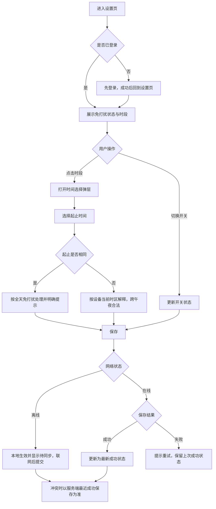
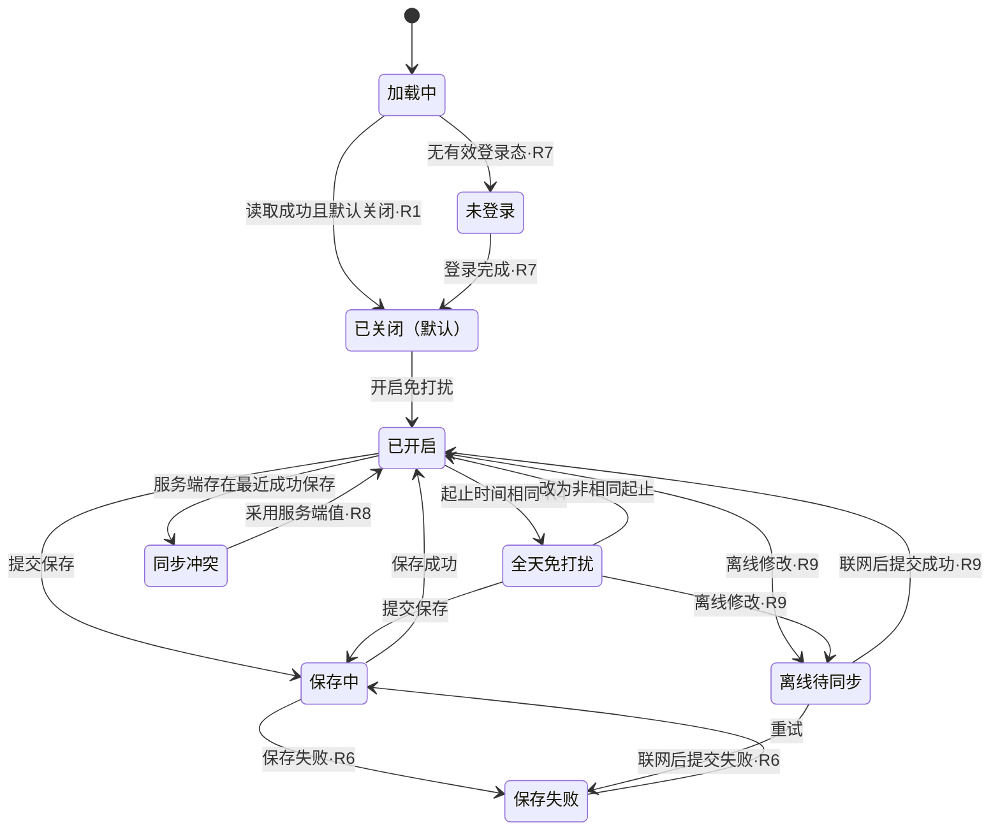
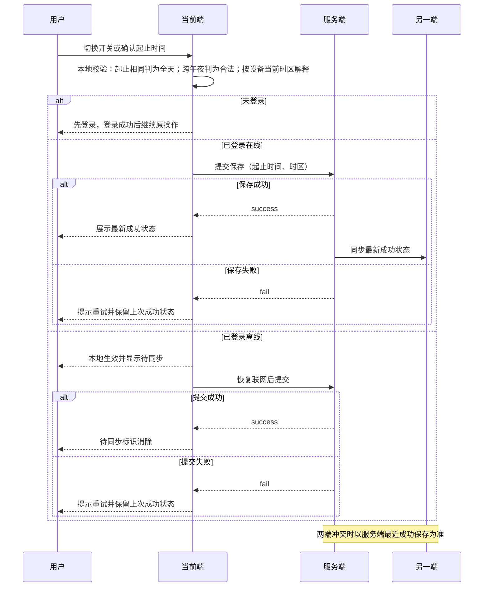

> **资料完整性提示：信息不充分**
> - 项目信息：缺少项目名称、需求责任人、评审角色与评审计划（对应上游缺口 G2）
> - 版本记录：缺少版本号、日期、变更说明，输入材料未提供任何版本条目
> - 需求目标的可度量口径：主动消息投诉率的分子、分母、统计周期、基线值与数据来源均未定义（缺口 G1）
> 另有3项缺口，详见文档的资料完整性列表。

# PRD文档

> 材料说明：本文全部输入来自单一来源 S1（软件 QA 人造测试材料，证据状态：测试数据）。文中「已确认」仅指该测试材料中已给定的功能规格，不代表真实业务评审已通过，也不构成验收结论。本文仅做归类、去重与编排，不新增统计、外部事实或产品决策。

## 项目信息

**材料不足**：输入材料未提供项目名称、需求责任人、评审角色与评审时间（对应缺口 G2）。

| 字段 | 内容 | 状态 |
| --- | --- | --- |
| 项目名称 | 待补 | 材料不足 |
| 需求名称 | 宠物免打扰设置（取自 S1 材料主题） | 来源 S1 |
| 需求责任人 | 待补 | 材料不足 |
| 评审角色 / 评审时间 | 待补 | 材料不足 |
| 涉及页面 | SET-DND-01 免打扰设置页、DLG-DND-TIME-01 时间选择弹层 | 来源 S1 |
| 品牌约束 | 主色 #315eb6；文案、字号、控件形态以设计交付为准 | 来源 S1（其余待确认） |

所需输入：责任人名单、评审角色与评审计划、项目编号（如有）。

## 版本记录

**材料不足**：输入材料未提供任何版本文档、版本号、日期或变更说明，本节无条目可填。

| 版本号 | 日期 | 变更说明 | 责任人 | 状态 |
| --- | --- | --- | --- | --- |
| 待补 | 待补 | 待补 | 待补 | 材料不足，无版本条目 |

所需输入：历史版本记录或首次发布版本号与日期、变更摘要、确认人。

## 需求背景

| 场景问题 | 影响 | 证据 | 证据状态 |
| --- | --- | --- | --- |
| 测试用户在工作时会被主动问候打断 | 缺少量化影响：无投诉量、无打断频次、无留存或退出数据 | S1 陈述 | 测试数据 |
| 当前测试版本无免打扰，主动问候全部直接展示 | 用户唯一可用手段是退出应用（S1 陈述），代价为放弃使用 | S1 陈述现有方案 | 测试数据 |
| 用户无法表达可打断时段 | 缺少可控时段配置能力 | 由「页面只有设置页及时间选择弹层」的规格反推 | 分析推断 |

现有方案与目标规格差距：

| 维度 | 现有测试版本 | 目标规格 | 差距性质 |
| --- | --- | --- | --- |
| 主动问候控制 | 无免打扰，全部直接展示 | 可开启、可按每日时段阻断 | 功能缺失（S1 已确认） |
| 用户应对方式 | 只能退出应用 | 应用内可控 | S1 已确认 |
| 时段能力 | 无 | 单个每日时段，跨午夜合法，起止相同为全天 | S1 已确认 |
| 多时段 / 按星期 | 无 | 明确不做 | 范围外（S1 已确认） |
| 推送机制 | 未说明 | 明确不重构 | 范围外（S1 已确认） |

本节缺口：打断问题的真实严重度与发生频率无任何材料支撑，不得以数值替代缺失证据。

## 需求目标

| 项 | 内容 | 状态 |
| --- | --- | --- |
| 目标 | 用户可开启免打扰并设置每日时间段；观察主动消息投诉率 | S1 已给定 |
| 目标值 | 待基线确认 | 待确认 |
| 指标分子（投诉定义） | 未定义（哪些反馈算投诉、是否含退出/卸载/客服） | 待确认 |
| 指标分母 | 未定义（活跃用户或收到主动消息的用户） | 待确认 |
| 统计周期 | 未定义（日/周/版本前后对比窗口） | 待确认 |
| 数据来源 | 未定义；现有埋点字典无投诉类事件 | 缺口 |
| 基线 | 无 | 缺口 |

缺失证据表：投诉率口径与基线整列缺失，本节无法形成可度量目标，也不生成任何趋势、分布、比例或留存类图形。所需输入：指标口径文档、基线数据、投诉事件定义。

## 需求概述

范围：本期仅包含一个设置页与一个时间选择弹层；范围外为多时间段、按星期与推送系统重构（S1 已确认，R10）。

| 页面 ID | 页面 | 所属边界 | 说明 |
| --- | --- | --- | --- |
| SET-DND-01 | 免打扰设置页 | 本期范围内 | 唯一设置入口，承载开关、时段展示与状态提示 |
| DLG-DND-TIME-01 | 时间选择弹层 | 本期范围内 | 设置每日起止时间 |
| — | 多时间段、按星期、推送系统改造 | 范围外（R10） | 不在本方案内 |

核心规则（S1 已确认）：

| 规则 ID | 规则 |
| --- | --- |
| R1 | 免打扰默认关闭 |
| R2 | 开启后默认 22:00–08:00 |
| R3 | 时间按设备当前时区解释，跨午夜合法 |
| R4 | 起止时间相同视为全天免打扰，并给出明确提示 |
| R5 | 仅阻止主动问候，不阻止用户主动聊天，喂养成长不暂停 |
| R6 | 保存失败提示重试并保留上次成功状态 |
| R7 | 未登录先登录 |
| R8 | 两端状态同步，冲突以服务端最近成功保存为准 |
| R9 | 离线可改，显示待同步，恢复联网后提交 |
| R10 | 范围外：多时间段、按星期、推送系统重构 |

## 业务流程图

源码依据上游材料 4.5，保持原用途（业务链路），未作规则改写。

## 交互流程图

### 页面状态流转（由「详细方案」状态表推导，分析推断）

本节状态箭头由 SET-DND-01 状态表编排推导，其中标有已确认规则的迁移依据 R1、R4、R6、R7、R9；其余迁移为分析推断，需评审确认。

### 同步时序（研发可复制源码，原用途保留）

下列时序源码来自上游材料，仅为规格描述，不代表运行验证。

## 详细方案

无真实原型截图，原型列统一标注「无原型（材料未提供）」，不伪造界面。一屏/状态一行。

### 免打扰设置页 SET-DND-01

| 一级模块 | 二级功能 | 原型 | 描述 |
| --- | --- | --- | --- |
| SET-DND-01 免打扰设置页 | S1-01 加载中 | 无原型（材料未提供） | 页面元素：页面标题、加载占位。交互说明：展示加载态，不提前写入默认值或上次值，避免闪现错误状态。边界：本期范围内。依据：分析推断。 |
| SET-DND-01 免打扰设置页 | S1-02 未登录 | 无原型（材料未提供） | 页面元素：登录引导与入口。交互说明：先登录，登录完成后回到设置页继续。边界：本期范围内。依据：R7 已确认。 |
| SET-DND-01 免打扰设置页 | S1-03 默认关闭（首次使用） | 无原型（材料未提供） | 页面元素：免打扰开关（关闭态）、时段入口。交互说明：默认关闭；时段入口是否展示默认 22:00–08:00 待确认（Q7）。边界：本期范围内。依据：R1 已确认＋待确认项。 |
| SET-DND-01 免打扰设置页 | S1-04 已开启 | 无原型（材料未提供） | 页面元素：开关（开启态）、当前时段文本、时间选择入口。交互说明：展示当前生效时段；点击时段进入 DLG-DND-TIME-01。边界：本期范围内。依据：R2 已确认。 |
| SET-DND-01 免打扰设置页 | S1-05 全天免打扰 | 无原型（材料未提供） | 页面元素：开关（开启态）、全天标识与明确提示。交互说明：起止相同时展示「全天」类提示文案，具体文案待确认（Q10）。边界：本期范围内。依据：R4 已确认＋待确认项。 |
| SET-DND-01 免打扰设置页 | S1-06 保存中 | 无原型（材料未提供） | 页面元素：保存中提示。交互说明：保存过程中不允许重复触发保存。边界：本期范围内。依据：分析推断。 |
| SET-DND-01 免打扰设置页 | S1-07 保存失败 | 无原型（材料未提供） | 页面元素：失败提示、重试入口、上次成功状态。交互说明：提示重试并保留上次成功状态；界面是否回退到上次成功值待确认（Q3）。边界：本期范围内。依据：R6 已确认＋待确认项。 |
| SET-DND-01 免打扰设置页 | S1-08 离线待同步 | 无原型（材料未提供） | 页面元素：待同步标识、当前可编辑控件。交互说明：允许修改并本地可见，显示待同步，恢复联网后提交；标识样式待确认。边界：本期范围内。依据：R9 已确认。 |
| SET-DND-01 免打扰设置页 | S1-09 同步冲突 | 无原型（材料未提供） | 页面元素：服务端最近成功保存的开关与时段。交互说明：以服务端最近成功保存为准；是否提示被覆盖待确认（Q4）。边界：本期范围内。依据：R8 已确认＋待确认项。 |
| SET-DND-01 免打扰设置页 | S1-10 状态读取失败 | 无原型（材料未提供） | 页面元素：未定义。交互说明：材料未覆盖该场景，兜底展示待确认（Q9）。边界：待确认。依据：缺口。 |

### 时间选择弹层 DLG-DND-TIME-01

| 一级模块 | 二级功能 | 原型 | 描述 |
| --- | --- | --- | --- |
| DLG-DND-TIME-01 时间选择弹层 | S2-01 打开弹层 | 无原型（材料未提供） | 页面元素：起始时间、结束时间、取消、确认。交互说明：打开时带入当前时段；未修改时确认不产生变更。边界：本期范围内。依据：分析推断。 |
| DLG-DND-TIME-01 时间选择弹层 | S2-02 编辑中（非跨午夜） | 无原型（材料未提供） | 页面元素：起止时间选择控件。交互说明：正常选择；时间粒度待确认（Q6）。边界：本期范围内。依据：S1 规格＋待确认项。 |
| DLG-DND-TIME-01 时间选择弹层 | S2-03 编辑中（跨午夜） | 无原型（材料未提供） | 页面元素：起止时间选择控件。交互说明：起 22:00、止 08:00 合法，不提示错误。边界：本期范围内。依据：R3 已确认。 |
| DLG-DND-TIME-01 时间选择弹层 | S2-04 起止相同 | 无原型（材料未提供） | 页面元素：全天提示。交互说明：给出明确提示后允许确认，确认后按全天免打扰生效；文案待确认。边界：本期范围内。依据：R4 已确认（文案待确认）。 |
| DLG-DND-TIME-01 时间选择弹层 | S2-05 取消 | 无原型（材料未提供） | 页面元素：取消按钮。交互说明：放弃本次修改，页面保持原值。边界：本期范围内。依据：分析推断。 |
| DLG-DND-TIME-01 时间选择弹层 | S2-06 确认 | 无原型（材料未提供） | 页面元素：确认按钮。交互说明：写回 SET-DND-01 并触发保存流程（在线/离线分支）。边界：本期范围内。依据：S1 规格推导。 |
| DLG-DND-TIME-01 时间选择弹层 | S2-07 弹层打开时设备时区变化 | 无原型（材料未提供） | 页面元素：未定义。交互说明：材料未覆盖，时区变更后的解释待确认（Q5）。边界：待确认。依据：缺口。 |

### 跨页共享规则（集中）

| 编号 | 规则 | 适用页面 | 类型 |
| --- | --- | --- | --- |
| X1 | 免打扰默认关闭 | SET-DND-01 | 已确认（R1） |
| X2 | 开启后默认 22:00–08:00 | SET-DND-01 | 已确认（R2） |
| X3 | 时间按设备当前时区解释，跨午夜合法 | SET-DND-01、DLG-DND-TIME-01 | 已确认（R3） |
| X4 | 起止相同＝全天免打扰，必须有明确提示 | SET-DND-01、DLG-DND-TIME-01 | 已确认（R4） |
| X5 | 免打扰只阻止主动问候；用户主动聊天不阻断；喂养成长不暂停 | 全局 | 已确认（R5） |
| X6 | 保存失败提示重试并保留上次成功状态 | SET-DND-01 | 已确认（R6） |
| X7 | 未登录先登录，完成后继续原操作 | SET-DND-01 | 已确认（R7） |
| X8 | 两端同步，冲突以服务端最近成功保存为准 | 全局 | 已确认（R8） |
| X9 | 离线可改＋待同步＋联网后提交 | SET-DND-01 | 已确认（R9） |
| X10 | 主色 #315eb6；文案、字号、控件形态以设计交付为准 | 全局 | 品牌色已确认，其余待确认 |
| X11 | 关闭后是否保留已选时段、失败回退展示方式、冲突提示方式 | SET-DND-01 | 待确认（R11–R13） |

### 异常与边界清单

| 编号 | 异常/边界 | 期望处理 | 类型 |
| --- | --- | --- | --- |
| E1 | 起止时间相同 | 全天免打扰＋明确提示 | 已确认（R4） |
| E2 | 跨午夜（起 > 止） | 合法，不报错 | 已确认（R3） |
| E3 | 保存失败 | 提示重试＋保留上次成功状态 | 已确认（R6） |
| E4 | 未登录 | 先登录再继续 | 已确认（R7） |
| E5 | 离线修改 | 待同步标识＋联网后提交 | 已确认（R9） |
| E6 | 两端冲突 | 服务端最近成功保存为准 | 已确认（R8） |
| E7 | 保存失败时开关显示与生效规则不一致 | 待确认 | 待确认（A2 分析推断） |
| E8 | 冲突覆盖本地修改的用户感知 | 待确认 | 待确认（A3 分析推断） |
| E9 | 设备时区变更后默认/已存时段的解释 | 待确认 | 待确认 |
| E10 | 首次进入读取状态失败、时间控件边界值 | 待确认 | 待确认 |

## 数据埋点

前两行为测试材料已给定的埋点字典，触发时机未给定，不得表述为已上线；其余为分析推断建议，需埋点评审确认后方可写入实施范围。

| 事件 | 参数 | 触发时机 | 状态 |
| --- | --- | --- | --- |
| dnd_toggle | enabled: boolean | 未给定 | 已给定事件与参数（触发时机待确认） |
| dnd_save | start_time: string, end_time: string, time_zone: string, result: success/fail | 未给定 | 已给定事件与参数（触发时机待确认） |
| dnd_page_view（建议） | 无 | 进入设置页 | 分析推断，待埋点评审 |
| dnd_timepicker_open / dnd_timepicker_cancel（建议） | 无 | 打开/取消弹层 | 分析推断，待埋点评审 |
| dnd_sync_pending（建议） | 无 | 进入待同步状态 | 分析推断，待埋点评审 |
| dnd_conflict_resolved（建议） | 无 | 冲突被服务端值覆盖 | 分析推断，待埋点评审 |
| dnd_login_required（建议） | 无 | 未登录被拦截 | 分析推断，待埋点评审 |
| 主动消息投诉类事件（建议） | 未定义 | 未定义 | 缺口，需与目标口径同步定义 |

本节缺口：无页面曝光、弹层操作、待同步、冲突覆盖、登录拦截、失败原因与投诉类事件；时间字段格式与时区字符串格式由埋点规范统一定义（Q6）。

## 待确认事项

### 资料不足（最重要的 3 项）

| 编号 | 缺口 | 影响 | 需要什么 |
| --- | --- | --- | --- |
| G1 | 主动消息投诉率无定义、无分母、无周期、无基线，且无对应投诉事件 | 目标不可度量，无法判断功能是否达成目标 | 指标口径文档＋基线数据＋投诉事件定义 |
| G2 | 责任人、评审角色、评审时间、版本记录均未给出 | 无法确定评审与签收路径，项目信息与版本记录章节无内容 | 责任人名单、评审计划、版本记录 |
| G3 | 无真实原型截图与设计规范，仅有品牌主色 #315eb6；文案、控件形态、时间粒度未给 | 逐屏方案无法定稿视觉与文案细节 | 原型稿或设计规范＋文案清单 |

### 其他待确认问题

| 编号 | 待确认问题 |
| --- | --- |
| Q1 | 「两端」具体指哪两端（同账号多设备、App 与 Web 或其他） |
| Q2 | 关闭免打扰后是否保留已选时段，重新开启是否复用 |
| Q3 | 保存失败时开关与时段是否回退展示上次成功值 |
| Q4 | 冲突被服务端值覆盖时是否向用户提示，提示形式 |
| Q5 | 设备时区变更后已保存时段如何解释，是否重算 |
| Q6 | 时间选择粒度（分钟/15 分钟）与 time_zone 字符串格式 |
| Q7 | 关闭态是否展示 22:00–08:00 默认时段 |
| Q8 | dnd_toggle、dnd_save 的上报时机与失败原因是否区分 |
| Q9 | 首次读取设置状态失败的兜底展示 |
| Q10 | 全天免打扰与待同步状态的提示文案及叠加展示规则 |