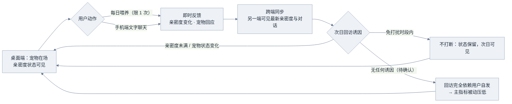
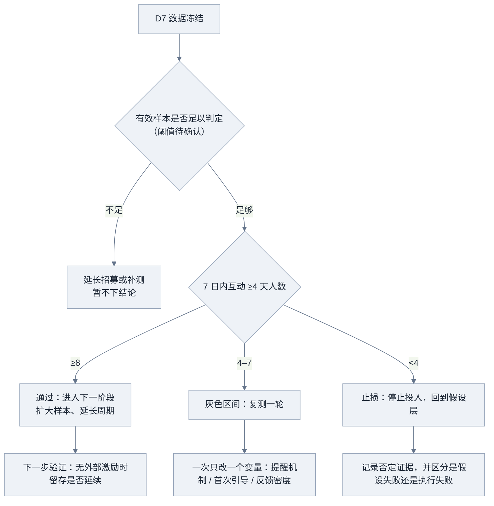

# MVP方案分析

> **材料性质**：本文全部输入来自一份标注为「软件QA人造测试材料」的文字输入，**不能当作真实市场证据或用户访谈**。文中所有取舍、排期、口径与风险判断均为**分析推断**，是建议而非用户已确认的决策；材料给定的约束、人力、预算、阈值按原文引用。当前无用户证据，属于必须标注的证据缺口。

## 核心结论

1. **可验证的最小闭环已由材料范围决定，本节点不建议扩张**：桌面端宠物显示 + 手机文字聊天 + 每日喂养一次 + 亲密度跨端同步 + 免打扰。但这五项本身是「功能集合」，不是「闭环」——闭环还缺一个**次日回访诱因**（推演，见 3.3）。
2. **核心假设「跨端持续陪伴有价值」无法被功能上线证明，只能被重复回访行为部分验证**。建议把单一假设拆成 H1 重复回访、H2 跨端同步被感知、H3 免打扰不破坏陪伴感、H4 相对短视频替代的偏好，其中只有 H1 进入主判定（分析推断）。
3. **通过线 ≥8 人、止损线 <4 人可以沿用，但判定口径必须先补齐**：何为一个「互动日」、7 天窗口从哪天起算、什么叫有效样本。口径不定，指标无法判读（分析推断）。
4. **砍掉社区、语音视频、医疗、硬件、装扮、付费不影响核心假设的可验证性**；其中去掉社区与语音反而是正向的——它们会引入社交驱动或内容新鲜度，混淆「陪伴价值」本身（分析推断）。
5. **最大风险不在功能，而在时间与样本**：3 人（含 1 名兼职设计）、4 周内要完成开发、招募、7 天观察与判定，材料未说明 4 周是否包含观察期。若包含，则**没有任何缓冲**，必须前置范围冻结（分析推断）。
6. **20 人样本不足以支撑统计意义上的结论**：8 人与 4 人在 n=20 下的区分能力有限，结论应表述为「方向性信号 / 是否值得继续投入」，而非「陪伴有价值已被证明」。此处未做统计功效计算（材料无相关输入，不编造数值）。

## 证据与分析

### 3.1 证据清单与缺口

| 编号 | 内容 | 证据性质 | 可用性 |
| --- | --- | --- | --- |
| mat-01 | 测试产品范围、人力、预算、周期、约束、招募人数与阈值（材料全文） | 测试数据（人造测试材料） | 可作为**约束与计划**引用，不可作为市场或用户事实 |
| mat-02 | 「现有替代方式为独自刷短视频」 | 材料陈述，无量化、无来源 | 只能作为待验证假设 |
| mat-03 | 「用户证据缺失须待验证」 | 材料自述 | 确认证据缺口存在 |

**缺失证据表（待补，不得以推断替代）**

| 待补内容 | 为什么影响方案 | 状态 |
| --- | --- | --- |
| 目标用户（独处上班族）的行为或访谈证据 | 决定闭环中的回访诱因是否成立 | 完全缺失 |
| 技术基线（是否已有代码/框架/账号体系） | 决定 4 周是否可行 | 完全缺失 |
| 2 万元预算构成 | 决定能否覆盖招募激励与云端资源 | 完全缺失 |
| AI 宠物回复的内容来源（预设脚本 / 模型调用） | 直接影响成本、时延与内容风险 | 完全缺失 |
| 招募渠道与 20 人来源 | 决定样本能否按时到位 | 完全缺失 |
| 「免打扰」是否等于「无任何主动提醒」 | 决定回访是否完全依赖用户自发，直接影响主指标 | 材料未明确 |

### 3.2 假设分解与可测性

| 子假设 | 内容 | 当前可测性 | 缺口 |
| --- | --- | --- | --- |
| H1（主） | 用户会在无外部强制下于 7 天内重复回访（≥4 天互动） | 可测，行为数据即可判定 | 无历史基线，无法区分「新鲜感」与「习惯」 |
| H2（辅） | 跨端亲密度同步被用户感知并强化连续感 | 部分可测（同步成功事件 + 双端查看） | 需补埋点定义；「感知」需 1 题自报告 |
| H3（辅） | 免打扰不破坏陪伴感 | 部分可测（免打扰开启率与其后互动变化） | 开启率过低时无判读意义 |
| H4（辅/定性） | 陪伴体验相对「独自刷短视频」有优势 | 弱可测，仅能自报告对比 | 自报告偏差大，不能替代行为指标 |

### 3.3 假设—功能—指标映射

| 子假设 | 本期功能 | 观测指标（口径见 4.4） | 作用 | 备注 |
| --- | --- | --- | --- | --- |
| H1 | 桌面宠物显示 + 每日喂养一次 | 7 日内互动 ≥4 天人数 | **主判定** | 唯一决定通过与止损 |
| H2 | 亲密度跨端同步 | 双端同步事件成功率；两端近 7 日均有活动的用户数 | 辅助解释 | 只用来说明 H1 成立或失败的原因 |
| H3 | 免打扰 | 免打扰开启人数与开启后互动天数变化 | 辅助解释 | 样本小，仅作定性 |
| H4 | 整体体验 | 简短自报告（1–2 题，D7 收集） | 定性补充 | 不作为判定依据 |

**读法提示**：主判定只看 H1 的一个人数指标；H2、H3、H4 只用于解释「为什么达标 / 为什么不达标」，不参与通过与否的裁决（分析推断）。这样可避免用多个弱指标拼出一个看似成立、实则无判读力的结论。

### 3.4 最小可用闭环（分析推断）

闭环必须闭合在「用户第二天为什么回来」上，而非闭合在「功能互相调用」上。

**闭环成立的关键前提（分析推断）**：
- 反馈必须**即时且可见**，否则喂养无法形成重复动作；
- 跨端同步必须**一端动作、另一端可感知**，这是「跨端」假设的唯一落地点；
- 若「免打扰」被理解为**完全没有主动提醒**，则回访诱因只剩「状态变化」，H1 的通过率会被结构性压低——这不代表假设为假，而是测试设计偏保守（重要待确认项）。

## 方案与规则

### 4.1 本期做（P0，全部为分析推断的最小实现标准）

| 功能 | 最小实现标准 | 支撑假设 | 不可再削减的部分 |
| --- | --- | --- | --- |
| 桌面端宠物显示 | 常驻可见，展示宠物形象与亲密度状态；可最小化不消失 | H1 | 状态可见性（否则无回访理由） |
| 手机端文字聊天 | 文本收发 + 宠物固定风格回应；不做语音、不做多轮长记忆 | H1、H4 | 回应的即时性与一致性 |
| 每日喂养一次 | 每日限 1 次，有明确冷却与完成反馈 | H1 | 「一天一次」的节奏（这是习惯验证的最小单位） |
| 亲密度跨端同步 | 喂养/聊天后另一端刷新可见；同步失败有重试 | H2 | 同步成功率可观测 |
| 免打扰 | 时段设置，时段内不发任何提示 | H3 | 需先确认它是否等于「无提醒」 |

> 需要指出：材料给定范围中**没有**「主动提醒/推送」项，也没有明确排除它。这是方案里唯一可能显著改变主指标结果的开关，必须由需求方拍定，不能由实现方默认（推断）。

### 4.2 本期不做（及理由）

| 不做项 | 理由 |
| --- | --- |
| 硬件 | 材料明确约束：仅软件 |
| 社区 | 材料约束排除；且社交驱动会混淆「陪伴价值」这一变量 |
| 语音 / 视频 | 材料约束排除；成本高、4 周内不可控 |
| 医疗类功能 | 材料约束排除；涉及资质与合规风险 |
| 多宠物 / 收集养成 | 增加内容与数值设计成本，不改变 H1 的可测性 |
| 装扮商城 / 任何付费 | 引入支付摩擦，改变招募样本的意愿结构，混淆主指标 |
| 复杂人设与长记忆对话 | 成本与内容风险不可控，并且不是验证「持续陪伴」的必要条件 |
| 社交分享、排行榜 | 靠外部刺激拉回访，会直接污染 H1 |

### 4.3 以后做（含触发条件，分析推断）

| 候选项 | 触发条件（满足再做） |
| --- | --- |
| 主动提醒 / 推送 | 数据显示回访在第 3–4 天明显跌落，且确认「免打扰」不等于「无提醒」 |
| 装扮 / 皮肤 | H1 达标后，作为提升长期动机的手段再验证（不能用来救回访） |
| 多宠物 | 单宠物互动已稳定，且用户明确提出收集需求 |
| 社区 | 陪伴价值已被验证，且已评估内容审核与运营成本 |
| 语音 | 文字互动量饱和，且用户明确表达语音偏好 |

### 4.4 「不做仍可验证」论证（关键判断）

| 被砍功能 | 若不做，核心假设是否仍可验证 | 说明 |
| --- | --- | --- |
| 社区 | **可验证，且更干净** | 社区提供的是社交驱动；去掉后 7 天回访只能由陪伴动机解释 |
| 语音 / 视频 | **可验证** | 影响体验强度，不影响「是否存在持续陪伴价值」 |
| 多宠物 / 装扮 | **可验证** | 影响动机强度与新鲜感，去掉后剩余动机更接近真实习惯 |
| 付费 | **可验证，且必要** | 付费会筛掉一部分样本，扭曲主指标 |
| 医疗 | **无关** | 与核心假设无逻辑关系 |
| 硬件 | **可验证** | 跨端同步已在「桌面 + 手机」内实现跨端检验 |
| 主动提醒 | **取决于是否为隐式必需** | 若回访完全依赖提醒，去掉后测的是「自发习惯」；若产品定位含提醒，去掉后测的就不是同一产品。**必须确认后再定** |

### 4.5 指标与判定规则（口径为分析推断，需确认）

| 规则项 | 建议定义 | 状态 |
| --- | --- | --- |
| 互动日 | 一个自然日内完成至少 1 次喂养，或发送至少 1 条消息；仅打开不算 | 待确认 |
| 7 天窗口 | 自该用户完成绑定并首次喂养起算 D0，连续 7 个自然日 | 待确认 |
| 有效样本 | 完成绑定且至少产生 1 条互动记录的用户；未完成绑定者剔除并替补 | 阈值待确认 |
| 主指标 | 7 日内互动 ≥4 天的**人数**（不是次数、不是比例） | 材料给定 |
| 通过 | ≥8 人 | 材料给定 |
| 止损 | <4 人 | 材料给定 |
| 灰色区间 | 4–7 人：调整后复测一轮 | 由材料区间推出（推断） |
| 换算说明 | 8/20 = 40%、4/20 = 20%，为**阈值换算**，不是观测结果 | 计算所得，非数据 |

**最小埋点清单（分析推断，仅用于让上述口径可计算）**：绑定完成、桌面端启动、喂养动作、消息发送条数、同步事件（成功/失败）、免打扰设置变更、最后一次活跃时间。不采集与判定无关的字段。

### 4.6 判定与决策路径（分析推断）

**止损的两类归因（必须区分，否则会误杀假设）**：一是假设本身不成立；二是执行问题（招募不达标、同步不稳定、宠物回应过于单调）。后者应先修复再复测，不计入否定证据（分析推断）。

### 4.7 依赖、成本与周期

**依赖（分析推断）**

| 依赖 | 影响 | 风险等级 |
| --- | --- | --- |
| 20 位独处上班族的招募渠道 | 无样本则无结论 | 高（材料未提供渠道） |
| 桌面端到手机端的同步链路 | H2 唯一落地点，故障会直接压低 H1 | 高 |
| 宠物回应内容供给 | 回应单调会导致第 2–3 天流失 | 中高（仅 1 名兼职设计） |
| 聊天与亲密度数据的存储与告知同意 | 涉及隐私合规 | 中（材料未提合规安排） |
| 埋点与统计口径 | 决定 D7 能否判读 | 中 |

**成本与周期（换算自材料给定值，非新事实）**

- 人力：1 客户端 + 1 服务端 + 0.5 设计 ≈ **10 人周**（4 + 4 + 2，按 4 周计；换算式推断）。
- 预算：2 万元（材料给定）。**构成未给出，不拆分具体金额**；可能的用途类别为招募激励、云端资源、素材/字体授权、应急，各项额度待确认。
- 周期：4 周（材料给定）。**是否包含 7 天观察期未说明**，两种情形差别极大：
  - 情形 A（含观察期）：约 W1–W2 开发，W2 末完成招募，W3 为 D0–D7，W4 判定 → **零缓冲**；
  - 情形 B（不含观察期）：总周期约 5 周，可保留 1 周缓冲。

### 4.8 反馈节奏（分析推断）

| 时点 | 事件 | 产出 | 是否出结论 |
| --- | --- | --- | --- |
| W1 末 | 可运行骨架（桌面显示 + 喂养 + 同步） | 内部可演示版本 | 否 |
| W2 中 | 招募启动（并行，不等到开发完成） | 意向名单 | 否 |
| W2 末 | 端到端可测（含聊天与免打扰）+ **范围冻结** | 冻结清单 | 否 |
| W3 初 | 2–3 人内部试跑（只查可用性与埋点） | 缺陷清单 | 否 |
| W3 D0 | 正式开放 | 正式开始日期 | 否 |
| W3 D3 | 埋点完整性检查（不看结果） | 数据可用性结论 | 否 |
| W4 D7 | 数据冻结 + 判定会 | 通过 / 灰色 / 止损 | **是** |

**节奏原则**：开发期不做结论，观察期不改进产品；一旦 D0 后改动功能，主指标就会被污染（分析推断）。

## 待确认与下一步

### 5.1 待确认清单（按阻塞程度排序）

| # | 待确认项 | 为什么阻塞 | 需要谁决定 |
| --- | --- | --- | --- |
| 1 | 4 周是否包含 7 天观察期 | 直接决定排期是零缓冲还是可留 1 周缓冲 | 需求方 |
| 2 | 「免打扰」是否等于「无任何主动提醒」 | 决定主指标是在「有诱因」还是「纯自发」条件下测得的 | 产品负责人 |
| 3 | 20 位目标用户的招募渠道与时间 | 无样本则 4 周方案不成立 | 需求方 / 运营 |
| 4 | 有效样本定义与替补规则 | 决定 D7 是否有资格判定 | 产品负责人 |
| 5 | 2 万元预算构成与可覆盖范围 | 决定招募激励与云端资源是否够 | 需求方 |
| 6 | 宠物回应的内容来源（预设脚本或模型调用） | 影响成本、时延与内容风险 | 技术负责人 |
| 7 | 是否存在可复用技术基线 | 影响 4 周可行性 | 技术负责人 |
| 8 | 聊天与亲密度数据的告知同意方式 | 影响能否合法采集与留存 | 需求方 |

### 5.2 下一步（建议动作，非已确认计划）

1. **先答 5.1 的第 1、2 项**，再冻结排期；这两项未定之前，其余排期都属于纸面推演。
2. **把 4.5 的口径写成 1 页测试方案**，与埋点清单一起评审，确保 D7 的数可算。
3. **W2 末范围冻结**，冻结后只修缺陷不加功能；任何新增功能都应放入 4.3 的「以后做」。
4. **招募与开发并行启动**，不要等版本完成才找人（最大进度风险）。
5. **D7 判定会同时记录否定证据**，特别是要写清「假设不成立」与「执行不到位」的区分依据。
6. **在 D7 后补一轮定性访谈**（3–5 人即可），解释主指标背后的原因；访谈提纲需先设计，不能临时提问（否则证据不可用）。

### 5.3 本轮结论的证据状态

| 内容 | 状态 |
| --- | --- |
| 产品范围、人力、预算、周期、20 人、≥8 / <4 阈值、约束项 | 材料给定（测试数据，非真实市场证据） |
| 假设拆分、闭环设计、范围取舍、口径、排期、风险与归因规则 | **分析推断**，未经验证 |
| 8/20=40%、4/20=20%、约 10 人周 | 由材料数值换算，非观测结果 |
| 用户需求、留存、偏好、竞品相关的一切陈述 | **无证据，全部待验证** |

> 本方案的任何通过/止损判断在 D7 之前都不存在；材料中的阈值是测试计划，不是已达成结果。