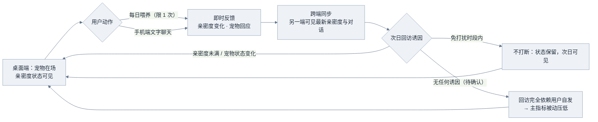
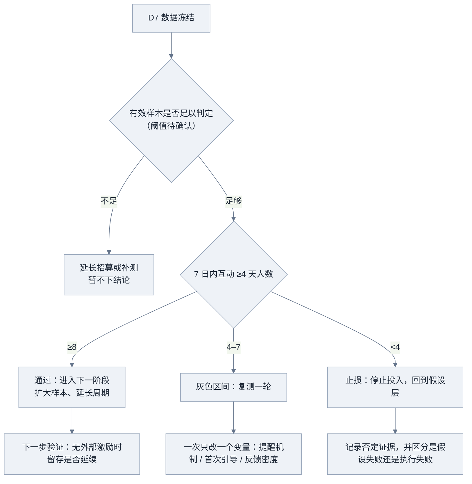

> **资料完整性提示：信息不充分**
> - 目标用户（独处上班族）的行为数据或访谈证据：当前仅有材料陈述，核心问题无量化、无来源
> - 「现有替代方式为独自刷短视频」的验证证据：仅为待验证假设，无样本与数据
> - 4 周周期是否包含 7 天观察期的确认：决定排期是否零缓冲，材料未说明
> - 「免打扰」是否等于「无任何主动提醒」的产品定义：决定回访诱因是否存在，直接影响主指标口径
> - 20 位目标用户的招募渠道、招募时间与到位保障：材料未提供
> - 有效样本定义与剔除/替补规则的最终确认：当前仅为本节点建议口径，待需求方拍定
> - 2 万元预算的构成与可覆盖范围（招募激励、云端资源、素材授权、应急）：未拆分
> - 技术基线（是否已有代码、框架、账号体系）与可复用程度：完全缺失，影响 4 周可行性
> - 宠物回应内容来源（预设脚本或模型调用）：影响成本、时延与内容风险，未定
> - 聊天与亲密度数据的告知同意与隐私合规安排：材料未提
> - 埋点清单与主指标统计口径的评审确认：现有埋点为分析推断，尚未定稿
> - 优先级排序依据（为何这五项为 P0、排序方法）与「主动提醒/推送」是否属于本期的决策
> - 竞品与替代方案的对比证据（含短视频替代的时间/频次数据）
> - 通过/止损阈值在 n=20 下的判读效力说明（统计功效）：材料明确未做计算

# MVP方案

> **资料不足声明（全文适用）**：本文只编排上游材料《MVP方案分析》。该材料自述来自一份标注为「软件QA人造测试材料」的文字输入，**不能当作真实市场证据或用户访谈**。文中范围、人力、预算、周期、20 人样本与通过/止损阈值属**材料给定的测试数据**；假设拆分、闭环设计、范围取舍、统计口径、排期推演与风险归因规则属**分析推断**，是建议而非已确认决策。目标用户行为证据、技术基线、招募渠道、预算构成、回应内容来源与合规安排均缺失，相关章节按「材料不足」处理，未做补齐。

## 目标用户与核心问题

### 材料给定内容

| 项 | 内容 | 证据性质 |
| --- | --- | --- |
| 目标用户 | 独处上班族 | 材料给定（测试数据，非真实用户证据） |
| 核心问题表述 | 现有替代方式为「独自刷短视频」 | 材料陈述，无量化、无来源，只能作为待验证假设 |
| 证据缺口自述 | 用户证据缺失须待验证 | 材料自述 |

来源：mat-01（材料全文）、mat-02（替代方式陈述）、mat-03（证据缺口自述）。

### 资料不足

| 待补内容 | 为什么影响方案 | 状态 |
| --- | --- | --- |
| 独处上班族的行为数据或访谈证据 | 决定闭环中的回访诱因是否成立 | 完全缺失 |
| 「独自刷短视频」的时间/频次与场景数据 | 决定核心问题是否真实存在、H4 是否有可比基线 | 完全缺失 |
| 用户对「陪伴」的具体期待与现有替代品清单 | 决定回应风格、喂养节奏是否与实际期望匹配 | 完全缺失 |

> 本节只能确认「材料声称的问题」，不能确认「问题真实存在」。任何用户规模、留存、偏好数字均无输入，本文不生成。

## 核心闭环

### 闭环结构（分析推断，待宿主渲染 Mermaid）

以下源码来自上游分析，保留原用途；当前环境未确认渲染器，**待宿主渲染**，其结论以本节文字与后续表格为准。

### 闭环要素对照

| 环节 | 本期承载功能 | 闭环作用 | 状态 |
| --- | --- | --- | --- |
| 在场 | 桌面端宠物显示 | 提供回访的去处与状态可见性 | 分析推断 |
| 动作 | 每日喂养一次、手机端文字聊天 | 形成可重复的最小行为单元 | 分析推断 |
| 反馈 | 亲密度变化、宠物回应 | 决定重复动作是否成立，必须即时可见 | 分析推断 |
| 跨端 | 亲密度跨端同步 | H2 的唯一落地点，「跨端」假设只能在此被检验 | 分析推断 |
| 回访诱因 | 无明确功能承载 | **闭环未闭合处**：材料未给主动提醒，也未明确排除 | 关键缺口 |

### 闭环成立的前提与缺口（分析推断）

- 反馈必须即时且可见，否则喂养无法形成重复动作。
- 跨端同步必须做到「一端动作、另一端可感知」，否则跨端假设未被真正检验。
- 若「免打扰」被理解为「完全没有主动提醒」，回访诱因只剩状态变化，H1 通过率会被结构性压低；这不等于假设为假，而是测试设计偏保守。此项**必须由产品负责人拍定**，不能由实现方默认。

## 本期范围与不做项

### 本期做（P0）

范围五项为材料给定；「最小实现标准」与「不可再削减部分」为分析推断。

| 功能 | 最小实现标准（分析推断） | 支撑假设 | 不可再削减的部分 |
| --- | --- | --- | --- |
| 桌面端宠物显示 | 常驻可见，展示宠物形象与亲密度状态；可最小化不消失 | H1 | 状态可见性（否则无回访理由） |
| 手机端文字聊天 | 文本收发 + 宠物固定风格回应；不做语音、不做多轮长记忆 | H1、H4 | 回应的即时性与一致性 |
| 每日喂养一次 | 每日限 1 次，有明确冷却与完成反馈 | H1 | 「一天一次」的节奏（习惯验证的最小单位） |
| 亲密度跨端同步 | 喂养/聊天后另一端刷新可见；同步失败有重试 | H2 | 同步成功率可观测 |
| 免打扰 | 时段设置，时段内不发任何提示 | H3 | 需先确认它是否等于「无提醒」 |

> 材料给定范围中**没有**「主动提醒/推送」项，也没有明确排除它。这是唯一可能显著改变主指标结果的开关，属未决项。

### 本期不做

| 不做项 | 理由 | 证据性质 |
| --- | --- | --- |
| 硬件 | 材料明确约束：仅软件 | 材料给定 |
| 社区 | 材料约束排除；社交驱动会混淆「陪伴价值」变量 | 材料给定 + 分析推断 |
| 语音 / 视频 | 材料约束排除；成本高、4 周内不可控 | 材料给定 + 分析推断 |
| 医疗类功能 | 材料约束排除；涉及资质与合规风险 | 材料给定 + 分析推断 |
| 多宠物 / 收集养成 | 增加内容与数值设计成本，不改变 H1 可测性 | 分析推断 |
| 装扮商城 / 任何付费 | 引入支付摩擦，改变招募样本意愿结构，混淆主指标 | 分析推断 |
| 复杂人设与长记忆对话 | 成本与内容风险不可控，非验证「持续陪伴」的必要条件 | 分析推断 |
| 社交分享、排行榜 | 靠外部刺激拉回访，直接污染 H1 | 分析推断 |

### 以后做（含触发条件，分析推断）

| 候选项 | 触发条件（满足再做） |
| --- | --- |
| 主动提醒 / 推送 | 数据显示回访在第 3–4 天明显跌落，且确认「免打扰」不等于「无提醒」 |
| 装扮 / 皮肤 | H1 达标后作为长期动机手段再验证，不能用来救回访 |
| 多宠物 | 单宠物互动已稳定，且用户明确提出收集需求 |
| 社区 | 陪伴价值已验证，且已评估内容审核与运营成本 |
| 语音 | 文字互动量饱和，且用户明确表达语音偏好 |

### 「不做仍可验证」论证（上游关键判断）

| 被砍功能 | 核心假设是否仍可验证 | 说明 |
| --- | --- | --- |
| 社区 | 可验证，且更干净 | 去掉社交驱动后，7 天回访只能由陪伴动机解释 |
| 语音 / 视频 | 可验证 | 影响体验强度，不影响「是否存在持续陪伴价值」 |
| 多宠物 / 装扮 | 可验证 | 去掉后剩余动机更接近真实习惯 |
| 付费 | 可验证，且必要 | 付费会筛掉部分样本，扭曲主指标 |
| 医疗 | 无关 | 与核心假设无逻辑关系 |
| 硬件 | 可验证 | 跨端同步已在「桌面 + 手机」内实现跨端检验 |
| 主动提醒 | 取决于是否为隐式必需 | 去掉后测的是「自发习惯」；若产品定位含提醒，则测的不是同一产品，须先确认 |

## 优先级

### 资料不足

材料**未提供优先级排序方法或评分依据**（无价值×成本、RICE、KANO 等输入），因此本节点**不自行排序**，也不生成优先级分值或排序结论。以下只整理材料中已有的结构性关系：哪些功能进入主判定、哪些只作解释、哪些被排除。

### 判定优先级（材料给定阈值 + 分析推断的读法）

| 层级 | 内容 | 依据 |
| --- | --- | --- |
| 唯一主判定 | 7 日内互动 ≥4 天人数 | 材料给定阈值 |
| 辅助解释，不参与裁决 | 双端同步成功率、两端近 7 日均有活动的用户数（H2）；免打扰开启人数与开启后互动天数变化（H3）；D7 自报告 1–2 题（H4） | 分析推断 |
| 范围外 | 见「本期不做」表 | 材料给定 + 分析推断 |

> 这样安排的作用是避免用多个弱指标拼出看似成立、实则无判读力的结论。此读法为分析推断，尚未经确认。

### 待决定的优先级问题

| # | 待确认项 | 影响 |
| --- | --- | --- |
| 1 | 五项 P0 之间是否存在先后或可否分批上线 | 若分批，主指标观察窗口需重新定义 |
| 2 | 「主动提醒/推送」是否属于本期 | 直接改变回访诱因结构，进而改变主指标含义 |
| 3 | 若 4 周内资源不足，先砍哪一项 | 材料未给出取舍顺序，本节点不代做决定 |

## 资源与周期

### 材料给定与换算

| 项 | 内容 | 证据性质 |
| --- | --- | --- |
| 人力 | 1 客户端 + 1 服务端 + 0.5 设计 = 3 人（含 1 名兼职设计） | 材料给定 |
| 人力换算 | 按 4 周计约 10 人周（4 + 4 + 2） | 换算式推断，非观测结果 |
| 预算 | 2 万元 | 材料给定，**构成未给出，不拆分具体金额** |
| 周期 | 4 周 | 材料给定，**是否包含 7 天观察期未说明** |

### 周期的两种情形（分析推断）

| 情形 | 假设 | 排布 | 缓冲 |
| --- | --- | --- | --- |
| A | 4 周**包含** 7 天观察期 | W1–W2 开发，W2 末完成招募，W3 为 D0–D7，W4 判定 | 零缓冲 |
| B | 4 周**不含**观察期 | 总周期约 5 周 | 可留约 1 周缓冲 |

> 该差异直接决定排期是否可行，属阻塞级未决项，须由需求方确认后本表才能收敛为单一方案。

### 依赖清单（风险等级为分析推断）

| 依赖 | 影响 | 风险等级 |
| --- | --- | --- |
| 20 位独处上班族的招募渠道 | 无样本则无结论 | 高（材料未提供渠道） |
| 桌面端到手机端的同步链路 | H2 唯一落地点，故障直接压低 H1 | 高 |
| 宠物回应内容供给 | 回应单调可能导致第 2–3 天流失 | 中高（仅 1 名兼职设计） |
| 聊天与亲密度数据的存储与告知同意 | 涉及隐私合规 | 中（材料未提合规安排） |
| 埋点与统计口径 | 决定 D7 能否判读 | 中 |

### 反馈节奏（分析推断，依赖情形 A）

| 时点 | 事件 | 产出 | 是否出结论 |
| --- | --- | --- | --- |
| W1 末 | 可运行骨架（桌面显示 + 喂养 + 同步） | 内部可演示版本 | 否 |
| W2 中 | 招募启动（与开发并行） | 意向名单 | 否 |
| W2 末 | 端到端可测（含聊天与免打扰）+ 范围冻结 | 冻结清单 | 否 |
| W3 初 | 2–3 人内部试跑（只查可用性与埋点） | 缺陷清单 | 否 |
| W3 D0 | 正式开放 | 正式开始日期 | 否 |
| W3 D3 | 埋点完整性检查（不看结果） | 数据可用性结论 | 否 |
| W4 D7 | 数据冻结 + 判定会 | 通过 / 灰色 / 止损 | 是 |

**节奏原则（分析推断）**：开发期不做结论，观察期不改进产品；D0 后改动功能会污染主指标。

### 资料不足

- 2 万元预算构成：完全缺失，无法判断能否覆盖招募激励与云端资源。
- 技术基线（是否已有代码、框架、账号体系）：完全缺失，4 周可行性无法评估。
- 招募渠道与时间：完全缺失。
- 宠物回应内容来源（预设脚本 / 模型调用）：完全缺失，影响成本、时延与内容风险。

## 验证指标与实验

### 假设分解（分析推断）

| 子假设 | 内容 | 当前可测性 | 缺口 |
| --- | --- | --- | --- |
| H1（主） | 用户会在无外部强制下于 7 天内重复回访（≥4 天互动） | 可测，行为数据即可判定 | 无历史基线，无法区分新鲜感与习惯 |
| H2（辅） | 跨端亲密度同步被用户感知并强化连续感 | 部分可测（同步成功事件 + 双端查看） | 需补埋点定义；「感知」需 1 题自报告 |
| H3（辅） | 免打扰不破坏陪伴感 | 部分可测（开启率与其后互动变化） | 开启率过低时无判读意义 |
| H4（辅/定性） | 陪伴体验相对独自刷短视频有优势 | 弱可测，仅能自报告对比 | 自报告偏差大，不能替代行为指标 |

### 假设—功能—指标映射

| 子假设 | 本期功能 | 观测指标 | 作用 |
| --- | --- | --- | --- |
| H1 | 桌面宠物显示 + 每日喂养一次 | 7 日内互动 ≥4 天人数 | 主判定 |
| H2 | 亲密度跨端同步 | 双端同步事件成功率；两端近 7 日均有活动的用户数 | 辅助解释 |
| H3 | 免打扰 | 免打扰开启人数与开启后互动天数变化 | 辅助解释（样本小，仅定性） |
| H4 | 整体体验 | D7 简短自报告 1–2 题 | 定性补充，不作判定依据 |

### 判定口径（建议定义，均为待确认）

| 规则项 | 建议定义 | 状态 |
| --- | --- | --- |
| 互动日 | 一个自然日内完成至少 1 次喂养，或发送至少 1 条消息；仅打开不算 | 待确认 |
| 7 天窗口 | 自用户完成绑定并首次喂养起算 D0，连续 7 个自然日 | 待确认 |
| 有效样本 | 完成绑定且至少产生 1 条互动记录的用户；未完成绑定者剔除并替补 | 阈值待确认 |
| 主指标 | 7 日内互动 ≥4 天的**人数**（不是次数、不是比例） | 材料给定 |
| 通过 | ≥8 人 | 材料给定 |
| 止损 | <4 人 | 材料给定 |
| 灰色区间 | 4–7 人：调整后复测一轮 | 由材料区间推出（推断） |
| 换算说明 | 8/20 = 40%、4/20 = 20%，为**阈值换算**，不是观测结果 | 计算所得，非数据 |

### 最小埋点清单（分析推断）

绑定完成、桌面端启动、喂养动作、消息发送条数、同步事件（成功/失败）、免打扰设置变更、最后一次活跃时间。不采集与判定无关的字段。

### 判定与决策路径（分析推断，待宿主渲染 Mermaid）

### 实验效力局限（材料自述与推断）

- 20 人样本不足以支撑统计意义上的结论；8 人与 4 人在 n=20 下的区分能力有限。结论应表述为「方向性信号 / 是否值得继续投入」，而非「陪伴有价值已被证明」。
- **未做统计功效计算**（材料无相关输入），本文不编造该数值。
- 若「免打扰」等于无任何主动提醒，H1 是在「纯自发」条件下测得，与含提醒的产品不是同一问题，须在结论中写明。

## 风险与止损

### 主要风险（分析推断，除标注外）

| # | 风险 | 影响 | 依据 |
| --- | --- | --- | --- |
| 1 | 4 周是否含观察期未定 | 含则零缓冲，任何延误直接吞掉判定窗口 | 材料未说明 |
| 2 | 招募不到位 | 无样本则 4 周方案不成立，最大进度风险 | 材料未提供渠道 |
| 3 | 同步链路不稳定 | H2 无法检验，并直接压低 H1 | 分析推断 |
| 4 | 宠物回应单调 | 第 2–3 天流失，可能被误读为假设失败 | 分析推断（仅 1 名兼职设计） |
| 5 | 「免打扰」定义未定 | 主指标口径不确定，结论不可比 | 材料未明确 |
| 6 | 统计口径与埋点未评审 | D7 数据不可算，判定无效 | 分析推断 |
| 7 | 隐私合规安排缺失 | 可能无法合法采集与留存聊天/亲密度数据 | 材料未提 |
| 8 | 样本量小 | 结论只能作方向性信号 | 材料自述 + 推断 |

### 止损判定与两类归因

止损线为材料给定：7 日内互动 ≥4 天人数 <4 人即止损；4–7 人为灰色区间，调整后复测一轮（推断）。

止损时必须区分两类归因，否则会误杀假设（分析推断）：

| 归因 | 含义 | 处理 |
| --- | --- | --- |
| 假设失败 | 无外部强制下确实没有重复回访 | 记录否定证据，回到假设层 |
| 执行失败 | 招募不达标、同步不稳定、回应过于单调、口径不可算 | 先修复再复测，不计入否定证据 |

### 阻塞级未决项

| # | 待确认项 | 为什么阻塞 | 需要谁决定 |
| --- | --- | --- | --- |
| 1 | 4 周是否包含 7 天观察期 | 决定排期是零缓冲还是可留 1 周缓冲 | 需求方 |
| 2 | 「免打扰」是否等于「无任何主动提醒」 | 决定主指标在「有诱因」还是「纯自发」条件下测得 | 产品负责人 |
| 3 | 20 位目标用户的招募渠道与时间 | 无样本则 4 周方案不成立 | 需求方 / 运营 |
| 4 | 有效样本定义与替补规则 | 决定 D7 是否有资格判定 | 产品负责人 |
| 5 | 2 万元预算构成与可覆盖范围 | 决定招募激励与云端资源是否够 | 需求方 |
| 6 | 宠物回应内容来源（预设脚本或模型调用） | 影响成本、时延与内容风险 | 技术负责人 |
| 7 | 是否存在可复用技术基线 | 影响 4 周可行性 | 技术负责人 |
| 8 | 聊天与亲密度数据的告知同意方式 | 影响能否合法采集与留存 | 需求方 |

### 下一步（建议动作，非已确认计划，分析推断）

1. 先答阻塞级第 1、2 项再冻结排期；这两项未定之前，其余排期都属于纸面推演。
2. 把判定口径写成 1 页测试方案，与埋点清单一起评审，确保 D7 的数可算。
3. W2 末范围冻结，冻结后只修缺陷不加功能；新增需求进入「以后做」。
4. 招募与开发并行启动，不等版本完成才找人。
5. D7 判定会同时记录否定证据，写清「假设不成立」与「执行不到位」的区分依据。
6. D7 后补一轮 3–5 人定性访谈解释主指标，访谈提纲须提前设计。

### 本轮结论的证据状态

| 内容 | 状态 |
| --- | --- |
| 产品范围、人力、预算、周期、20 人、≥8 / <4 阈值、约束项 | 材料给定（测试数据，非真实市场证据） |
| 假设拆分、闭环设计、范围取舍、口径、排期、风险与归因规则 | 分析推断，未经验证 |
| 8/20=40%、4/20=20%、约 10 人周 | 由材料数值换算，非观测结果 |
| 用户需求、留存、偏好、竞品相关的一切陈述 | 无证据，全部待验证 |

> 本方案的任何通过/止损判断在 D7 之前都不存在；材料中的阈值是测试计划，不是已达成结果。