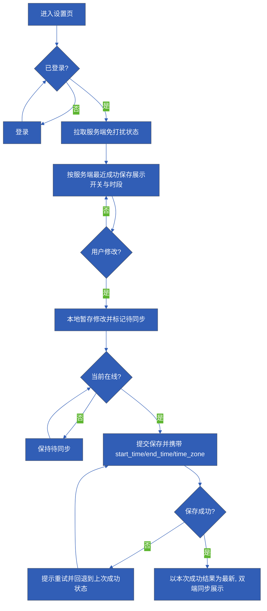
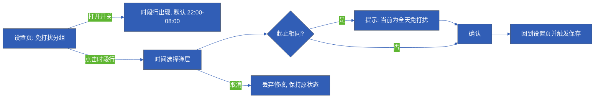

# PRD方案分析

> 材料性质：本次输入被标注为“软件QA人造测试材料”，不是真实市场证据或用户访谈。本文所涉产品规则均为该测试材料给定的输入，证据状态统一为**测试数据**；在此基础上做出的补充建议一律标注**分析推断**。本文供 PRD 报告节点整理使用，未经过任何实际校验，不构成已验收的 PRD，也不代表任何指标已达成。

## 核心结论

- **范围界定清晰，涵盖范围很小**：本需求只有两个界面单元，即免打扰设置页与时间选择弹层；明确排除多时间段、按星期设置、推送系统重构，不扩展社区与商业模式。
- **规则链可直接转写为 PRD 规则条目**：默认关闭；开启默认 22:00–08:00（设备当前时区、跨午夜合法）；起止相同=全天并明确提示；仅阻止主动问候，不阻止用户主动聊天，喂养成长不暂停；保存失败提示重试并保留上次成功状态；未登录先登录；双端以服务端最近成功保存为准；离线可改、显示待同步、联网后提交。
- **目标可以定义定义方式，但当前不可验收**：材料明确“无访谈、无基线，目标值待基线确认”；同时已有埋点字典内没有投诉类事件，因此“主动消息投诉率”无法从现有埋点算出，这是关键证据缺口。
- **三个最主要的证据缺口**：①没有真实访谈、基线与投诉数据；②没有原型截图，页面元素只能描述到规格级，视觉与布局需要设计补充（品牌主色 #315eb6 已知）；③人员和责任方未知，埋点字段格式与是否上线未知，且材料明确不得表述为已上线。
- **章节取舍**：本文只覆盖“宠物免打扰设置”单一需求的页面规格、状态、异常、共享规则、埋点与待确认项；不写社区、商业模式、推送架构与成长玩法改版；不写技术接口与时序实现细节之外的系统设计。

## 证据与分析

### 材料盘点与来源性质

| 编号 | 材料 | 来源性质 | 可用于 | 局限 |
| --- | --- | --- | --- | --- |
| M1 | 文字输入（id c9166cd7-86b4-4f14-817f-c57afdce5b58）：需求名、背景、目标、页面范围、规则、范围外、埋点字典、品牌色、现有方案 | 测试数据（人造材料） | 规则条目、页面与状态规格、埋点字段清单 | 不可作为市场或用户证据；无数据、无原型、无人员 |
| M2 | 品牌主色 #315eb6 | 测试数据内给定 | 视觉标注 | 无设计稿、无明暗模式与无障碍规范 |
| M3 | 现有埋点字典（dnd_toggle、dnd_save） | 测试数据内给定 | 埋点方案草案 | 字段格式未定、是否上线未知、缺投诉类事件 |

证据缺口说明：本文未做任何外部检索，也没有可用访谈、日志或投诉数据；凡涉及数量、比例、趋势的结论一律不生成，改以“缺失证据表”形式说明待补内容。

### 已确认项（材料给定输入，证据状态：测试数据）

| 编号 | 已确认内容 | 影响章节 |
| --- | --- | --- |
| C1 | 需求名：宠物免打扰设置；本 PRD 只做该需求 | 全文 |
| C2 | 页面只有设置页与时间选择弹层 | 方案与规则·页面总览 |
| C3 | 默认关闭免打扰 | 设置页状态、共享规则 |
| C4 | 开启后默认 22:00–08:00 | 设置页、时间弹层、埋点 |
| C5 | 时段按设备当前时区解释，跨午夜合法 | 共享规则、时间弹层 |
| C6 | 起止时间相同视为全天免打扰，并有明确提示 | 时间弹层、异常与状态 |
| C7 | 免打扰仅阻止主动问候，不阻止用户主动聊天 | 共享规则（业务边界） |
| C8 | 喂养成长不暂停 | 共享规则（业务边界） |
| C9 | 保存失败提示重试，并保留上次成功状态 | 设置页异常、共享规则 |
| C10 | 未登录先登录 | 设置页状态、共享规则 |
| C11 | 双端状态同步，冲突以服务端最近成功保存为准 | 共享规则、异常清单 |
| C12 | 离线可修改，显示待同步，恢复联网后提交 | 设置页状态、异常清单 |
| C13 | 范围外：多时间段、按星期、推送系统重构 | 章节取舍、共享规则 |
| C14 | 埋点字典：dnd_toggle(enabled:boolean)；dnd_save(start_time,end_time,time_zone,result∈{success,fail})，且不得写成已上线 | 埋点方案 |
| C15 | 品牌主色 #315eb6；无真实原型截图 | 视觉标注、证据缺口 |

### 待确认项（不得当作已确认写入 PRD）

| 编号 | 待确认事项 | 为何阻塞 | 影响章节 |
| --- | --- | --- | --- |
| Q1 | “主动消息投诉率”的统计方式：投诉入口、分子、分母（收到主动问候的用户数或消息条数）、统计周期、是否区分主动与被动 | 无统计方式与基线，目标不可验收 | 目标与统计方式 |
| Q2 | 目标值与基线（材料明确待基线确认） | 无法判断是否达成 | 目标与统计方式 |
| Q3 | 现有埋点字典无投诉类事件，指标无法由 dnd_toggle、dnd_save 计算 | 指标与埋点断裂 | 埋点方案、目标 |
| Q4 | “两端”具体指哪两端（如 iOS、Android；移动端、桌面端） | 同步规则无法描述具体范围 | 共享规则 |
| Q5 | start_time、end_time 的传参格式（HH:mm 还是带日期）与 time_zone 格式（IANA 或偏移） | 埋点与保存逻辑无法确定 | 埋点方案 |
| Q6 | dnd_toggle 的触发时机：开关切换即上报，还是保存成功后上报 | 影响“切换次数”统计方式 | 埋点方案 |
| Q7 | 未登录判定时机：进入设置页即拦截，还是点击开关时拦截 | 影响首个页面状态 | 设置页状态 |
| Q8 | 离线期间另一端已成功保存、联网后本地提交被服务端覆盖时，是否需要显式提示用户 | 影响异常体验与文案 | 异常与状态 |
| Q9 | 保存失败的“重试”是用户手动重试、自动重试还是两者都有；重试次数与超时 | 影响失败态规格 | 异常与状态 |
| Q10 | 全天（起止相同）时段的展示形态：显示“全天”还是“22:00–22:00” | 影响时段行文案 | 设置页、时间弹层 |
| Q11 | 设备时区变更后，已保存时段的解释与提示 | 影响跨时区一致性 | 共享规则 |
| Q12 | 免打扰开启后是否需要在会话页提供可见状态标识 | 材料未提，不自行扩范围 | 章节取舍 |
| Q13 | 人员、评审与验收责任方 | 无法指派待办 | 待确认与下一步 |
| Q14 | 是否需要无障碍、多语言、暗色模式适配 | 影响视觉与文案规格 | 视觉标注 |

### 背景：场景—问题—影响—证据

| 场景 | 问题 | 影响 | 证据（性质） | 证据缺口 |
| --- | --- | --- | --- | --- |
| 用户在工作时使用应用 | 主动问候会在用户不希望被打断的时段直接出现 | 打断专注；用户唯一可用的规避方式是退出应用 | 测试材料陈述（测试数据） | 没有访谈、没有打断频次或投诉量数据、没有基线；影响程度不可量化 |
| 用户希望“只在某些时段安静” | 当前测试版本没有免打扰能力，主动问候全部直接展示 | 用户无法在保留应用的同时避免主动消息 | 材料“现有方案”段（测试数据） | 没有竞品或替代方案对比材料 |
| 用户跨午夜需要安静（如 22:00–08:00） | 时段跨天，若按单日区间处理会出现非法区间 | 时段规则若不明确将无法实现 | 材料规则（测试数据） | 无 |

说明：以上“影响”仅为定性描述，本文不生成任何频次、比例或趋势数字；如需量化，须等 Q1、Q2 补齐后另行取证。

### 目标与统计方式

| 目标 | 统计方式定义 | 分母／周期 | 基线 | 目标值 | 状态 |
| --- | --- | --- | --- | --- | --- |
| 用户可开启免打扰并设置每日时间段 | 开关状态与起止时段可保存，并在双端回读一致（功能达成判定） | 不适用（功能项） | 当前测试版本无该能力（不可用） | 待确认 | 待实现，未验证 |
| 观察主动消息投诉率 | 分子：投诉主动消息的次数或人数；分母：同期收到主动问候的用户数或消息条数；周期：待定 | 待确认 | **缺失**（材料明确无基线） | 待基线确认 | 待验证，不可验收 |
| 降低工作时段被打断 | 未定义 | — | 缺失 | — | 不可入 PRD，列为证据缺口 |

结论：本需求当前只能给出“功能达成”的判定方式；“投诉率”只能作为待验证观察指标，且缺少对应埋点（Q3），不得在任何文档中表述为已达成或已验证。

## 方案与规则

### 页面与边界总览

| 编号 | 页面／层级 | 所属边界 | 说明 | 证据状态 |
| --- | --- | --- | --- | --- |
| P1 | 免打扰设置页 | 应用设置内，仅承载免打扰开关与时段行 | 唯一主页面 | 测试数据（材料给定） |
| P2 | 时间选择弹层 | 覆盖在 P1 之上，仅承载起止时间选择与确认／取消 | 唯一弹层 | 测试数据（材料给定） |
| — | 不涉及：会话页、推送服务、成长喂养逻辑 | 范围外 | 免打扰只影响主动问候的展示判定，不改变成长逻辑 | 测试数据（材料给定） |

视觉标注：主色 #315eb6（品牌主色，材料给定）；无原型截图，以下元素清单为规格级，布局、字号、间距、明暗模式由设计补充（Q14）。

### P1 免打扰设置页

**页面元素（规格级）**

| 编号 | 元素 | 说明 | 所属边界 | 证据状态 |
| --- | --- | --- | --- | --- |
| P1-E1 | 页面标题与返回 | 进入设置页的常规导航 | 本页 | 分析推断（导航形态待设计确认） |
| P1-E2 | “免打扰”分组标题 | 分组入口，说明该设置的作用 | 本页 | 分析推断（文案待定） |
| P1-E3 | 免打扰开关 | 二元开关，默认关闭（C3） | 本页 | 测试数据（C3） |
| P1-E4 | 时段行 | 开启后显示当前生效时段，默认“22:00–08:00”（C4） | 本页 | 测试数据（C4） |
| P1-E5 | 全天提示文案 | 起止相同时，明确提示当前为全天免打扰（C6） | 本页与 P2 共用 | 测试数据（C6），文案待定 |
| P1-E6 | 时区说明 | 说明时段按设备当前时区生效（C5） | 本页 | 测试数据（C5），展示形态待定 |
| P1-E7 | 状态提示区 | 展示“待同步”“保存失败”等状态 | 本页 | 测试数据（C9、C12），形态待定 |

**页面状态（每个状态一屏）**

| 状态 | 触发条件 | 页面表现 | 交互说明 | 异常与提示 | 证据状态 |
| --- | --- | --- | --- | --- | --- |
| S1 未登录 | 未登录用户进入 | 先完成登录再进入设置页 | 未登录先登录（C10） | 登录中断后回到原入口，不保留未提交修改 | 测试数据（C10），拦截时机见 Q7 |
| S2 已登录·关闭态（默认） | 首次进入或用户关闭 | 开关为关；时段行隐藏或置灰 | 打开开关即启用默认时段 22:00–08:00 | 无 | 测试数据（C3、C4），隐藏或置灰待确认 |
| S3 开启态·在线已保存 | 开关打开且保存成功 | 开关为开；时段行显示当前时段 | 点击时段行打开 P2 | 无 | 测试数据（C4） |
| S4 开启态·离线待同步 | 离线时修改（开关或时段） | 开关与时段显示本地新值；状态提示区显示“待同步” | 可继续修改；恢复联网后自动提交（C12） | 待同步期间不宣称已生效于服务端 | 测试数据（C12） |
| S5 保存中 | 提交保存请求 | 开关与时段显示目标值，状态提示区显示保存中 | 保存中重复操作的处理待确认 | 无 | 分析推断（材料未规定保存中态） |
| S6 保存失败 | 保存返回失败 | 回退并保留上次成功状态；状态提示区提示重试 | 提供重试入口（C9） | 提示“保存失败，请重试”；重试方式见 Q9 | 测试数据（C9） |
| S7 加载中 | 进入页面拉取服务端状态 | 展示骨架或占位 | 加载完成前不允许修改 | 无 | 分析推断（材料未规定） |
| S8 拉取失败 | 拉取服务端状态失败 | 提示重试；不回退到本地臆测值 | 重试后重新拉取 | 与 S6 文案需区分 | 分析推断（材料未规定） |

> 说明：S5、S7、S8 为分析推断的补齐建议，材料未给出，需确认后方可写入正式 PRD；S2 的“隐藏或置灰”同样待设计确认。

### P2 时间选择弹层

**页面元素（规格级）**

| 编号 | 元素 | 说明 | 所属边界 | 证据状态 |
| --- | --- | --- | --- | --- |
| P2-E1 | 开始时间选择 | 小时与分钟选择，默认 22:00（C4） | 弹层 | 测试数据（C4） |
| P2-E2 | 结束时间选择 | 小时与分钟选择，默认 08:00（C4） | 弹层 | 测试数据（C4） |
| P2-E3 | 时区只读说明 | 显示按设备当前时区生效，不可在此修改时区（C5） | 弹层 | 测试数据（C5） |
| P2-E4 | 全天提示 | 起止相同时实时提示“当前为全天免打扰”（C6） | 弹层 | 测试数据（C6），文案待定 |
| P2-E5 | 确认与取消 | 确认提交并触发保存；取消放弃本次修改 | 弹层 | 测试数据（隐含于 C4、C9），按钮文案待定 |

**弹层状态与交互**

| 状态 | 触发 | 表现与交互 | 异常 | 证据状态 |
| --- | --- | --- | --- | --- |
| T1 默认打开 | 从 S3／S4 点击时段行 | 带入当前生效时段，光标或焦点落在开始时间 | 无 | 分析推断（带入值形态待确认） |
| T2 跨午夜区间 | 起止落在不同日（如 22:00–08:00） | 视为合法区间，不做非法校验，展示为“22:00–08:00” | 无 | 测试数据（C5） |
| T3 起止相同 | 起止小时分钟完全一致 | 提示当前为全天免打扰并保持可确认 | 提示文案与展示形态见 Q10 | 测试数据（C6） |
| T4 取消 | 点击取消或关闭弹层 | 丢弃本次修改，页面保持上次成功状态 | 无 | 测试数据（隐含），行为待确认 |
| T5 确认后保存失败 | 确认后提交失败 | 回到设置页并进入 S6 | 提示重试 | 测试数据（C9） |

### 跨页共享规则（集中定义，各屏复用）

| 编号 | 规则 | 说明 | 证据状态 |
| --- | --- | --- | --- |
| R1 | 默认关闭 | 无本地与服务端配置时，免打扰为关闭 | 测试数据（C3） |
| R2 | 默认时段 | 首次开启时生效 22:00–08:00 | 测试数据（C4） |
| R3 | 时区 | 时段一律按设备当前时区解释；存储需携带时区标识 | 测试数据（C5），格式见 Q5 |
| R4 | 跨午夜 | 结束时间早于开始时间视为跨午夜，合法 | 测试数据（C5） |
| R5 | 全天 | 起止相同视为全天免打扰，需明确提示 | 测试数据（C6） |
| R6 | 作用范围 | 免打扰只阻止主动问候展示；用户主动发起聊天不受影响 | 测试数据（C7） |
| R7 | 与成长的关系 | 免打扰期间喂养与成长逻辑不暂停、不改判 | 测试数据（C8） |
| R8 | 保存成功 | 以服务端返回的成功结果作为唯一生效依据 | 测试数据（C9、C11） |
| R9 | 保存失败 | 提示重试，并保留上次成功状态，不写入失败值 | 测试数据（C9） |
| R10 | 登录门槛 | 未登录先登录，登录后回到设置入口 | 测试数据（C10），时机见 Q7 |
| R11 | 双端同步 | 双端展示以服务端最近一次成功保存为准 | 测试数据（C11），具体两端见 Q4 |
| R12 | 冲突处理 | 冲突时服务端最近成功保存覆盖本地未提交值；是否提示见 Q8 | 测试数据（C11） |
| R13 | 离线 | 离线可修改并显示待同步；恢复联网后提交 | 测试数据（C12） |
| R14 | 范围外 | 不做多时间段、不做按星期、不做推送系统重构 | 测试数据（C13） |

### 业务流程与交互流程（分开表述）

**业务流程（状态与数据为准，供研发复制源码）**

**交互流程（用户操作路径，与业务规则分开）**

> 图注：两张图分别描述业务状态流转与用户操作路径，二者不互相替代。Mermaid 源码已给出，图形渲染由宿主完成；若当前环境无渲染器，请以上方规则表与状态表为准，本文不宣称图表已渲染。

### 异常与状态清单

| 编号 | 异常或状态 | 触发条件 | 页面表现 | 数据结果 | 待确认点 |
| --- | --- | --- | --- | --- | --- |
| E1 | 未登录 | 未登录访问设置页 | 转登录 | 不产生保存 | Q7 拦截时机 |
| E2 | 保存失败 | 保存返回失败 | 提示重试，回退到上次成功状态 | 服务端状态不变 | Q9 重试方式 |
| E3 | 离线修改 | 无网络时修改 | 显示待同步 | 本地暂存，未提交 | 待同步期间的修改合并方式 |
| E4 | 联网后提交 | 恢复网络 | 待同步状态消失或转为失败 | 提交最新本地值 | 与 E5 的先后顺序 |
| E5 | 双端冲突 | 另一端已成功保存 | 以服务端最近成功保存为准 | 本地值被覆盖 | Q8 是否提示 |
| E6 | 起止相同 | 用户选成同一时间 | 全天提示 | 保存为全天语义 | Q10 展示形态 |
| E7 | 跨午夜 | 结束早于开始 | 正常展示 | 合法区间 | 无 |
| E8 | 设备时区变更 | 系统时区变化 | 待确认 | 待确认 | Q11 |
| E9 | 加载或拉取失败 | 进入页面拉取失败 | 提示重试 | 不采用臆测值 | 分析推断，需确认 |

### 埋点方案

> 以下事件与参数来自材料给定的埋点字典（测试数据）；**均不得表述为已上线**。字段格式（Q5）与触发时机（Q6）未定，正式 PRD 需补齐后再交研发。

| 事件 | 触发时机 | 参数 | 类型 | 取值 | 状态 |
| --- | --- | --- | --- | --- | --- |
| dnd_toggle | 用户切换免打扰开关时（具体为切换即上报还是保存成功后上报待确认） | enabled | boolean | true／false | 字典给定，未上线 |
| dnd_save | 保存免打扰时段后 | start_time | string | 格式待确认 | 字典给定，未上线 |
| dnd_save | 保存免打扰时段后 | end_time | string | 格式待确认 | 字典给定，未上线 |
| dnd_save | 保存免打扰时段后 | time_zone | string | 格式待确认（IANA 或偏移） | 字典给定，未上线 |
| dnd_save | 保存免打扰时段后 | result | 枚举 | success／fail | 字典给定，未上线 |

**埋点缺口（缺失证据表）**

| 缺口 | 影响 | 说明 |
| --- | --- | --- |
| 无投诉类事件 | 目标“主动消息投诉率”无法计算 | 需另行定义投诉上报事件与其统计方式（Q1、Q3） |
| 无主动问候曝光或下发事件 | 无法确定投诉率分母 | 需确认是否复用既有推送或会话埋点，材料未提供 |
| 无免打扰生效期内的拦截计数 | 无法验证“仅阻止主动问候”的实际效果 | 材料未提供，不自行扩字段 |
| 无用户或设备标识字段 | 无法按端拆分同步问题 | 材料未提供，不自行扩字段 |

## 待确认与下一步

### 待确认事项与影响

| 编号 | 事项 | 影响 | 阻塞程度 | 责任方 |
| --- | --- | --- | --- | --- |
| Q1 | 投诉率的分子、分母、周期与投诉入口 | 目标不可验收 | 高 | 待指派（人员未知） |
| Q2 | 基线与目标值 | 目标不可验收 | 高 | 待指派 |
| Q3 | 是否新增投诉类埋点 | 指标无法计算 | 高 | 待指派 |
| Q4 | “两端”的具体定义 | 同步规则范围不清 | 中 | 待指派 |
| Q5 | start_time、end_time、time_zone 格式 | 埋点与保存无法实现 | 高 | 待指派（研发） |
| Q6 | dnd_toggle 触发时机 | 统计方式歧义 | 中 | 待指派 |
| Q7 | 未登录拦截时机 | 首个页面状态不定 | 中 | 待指派 |
| Q8 | 冲突覆盖是否提示用户 | 异常体验不定 | 中 | 待指派 |
| Q9 | 重试方式与次数 | 失败态规格不定 | 中 | 待指派 |
| Q10 | 全天的展示形态与文案 | 文案不一致 | 低 | 待指派（设计） |
| Q11 | 设备时区变更后的处理 | 跨时区一致性 | 中 | 待指派 |
| Q12 | 是否需要会话页可见的免打扰标识 | 范围可能扩张 | 低 | 待指派 |
| Q13 | 人员与评审责任方 | 无法排期 | 高 | 待指派 |
| Q14 | 无障碍、多语言、暗色模式 | 视觉规格不全 | 低 | 待指派（设计） |

### 下一步（供报告节点整理，不含新的事实主张）

1. 先关闭高阻塞项 Q1、Q2、Q3、Q5、Q13：投诉统计方式与基线、埋点字段格式、责任人；在此之前，报告中的“目标”只能写成“待验证观察指标 ＋ 功能达成判定”。
2. 补齐设计输入：以 #315eb6 为主色输出 P1、P2 的界面稿与文案（全天提示、保存失败提示、待同步提示），替换本文的规格级元素描述。
3. 确认本文标注为“分析推断”的状态 S5、S7、S8 与 E9 是否纳入正式 PRD，未确认则不进正文规则。
4. 埋点部分在格式与触发时机确认后，再由研发对照实现；任何文档不得表述为已上线。
5. 全部规则与结论的证据性质保持为“测试数据”，在报告节点合并时不得改写为真实用户结论或已验收 PRD。

### 章节取舍说明

| 内容 | 是否纳入 | 理由 |
| --- | --- | --- |
| 免打扰设置页与时间弹层的元素、状态、异常、规则、埋点 | 纳入 | 材料给定的需求范围 |
| 多时间段、按星期 | 不纳入 | 材料明确范围外 |
| 推送系统重构 | 不纳入 | 材料明确范围外 |
| 社区、商业模式 | 不纳入 | 用户与材料均限定为单需求 |
| 投诉率的具体数值与趋势图 | 不纳入 | 无数据、无基线、无埋点，属证据缺口 |
| 竞品与市场接受度分析 | 不纳入 | 本次评估对象是已确认功能规格，不是市场接受度 |