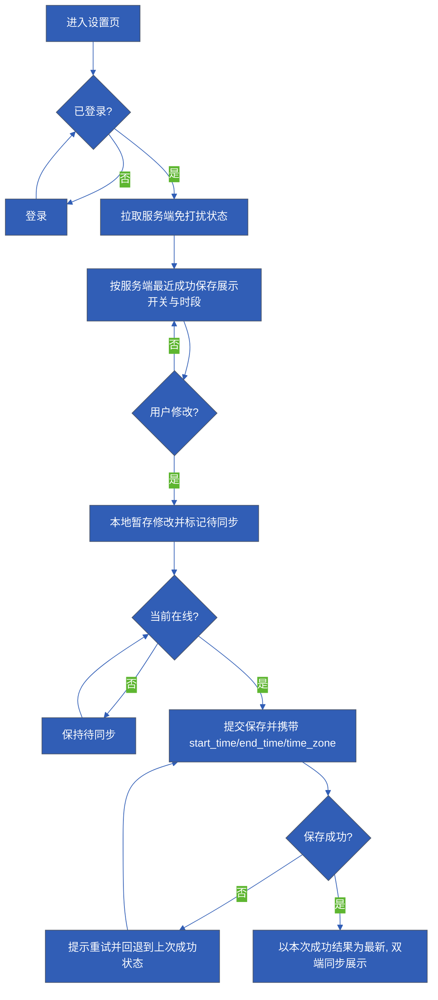
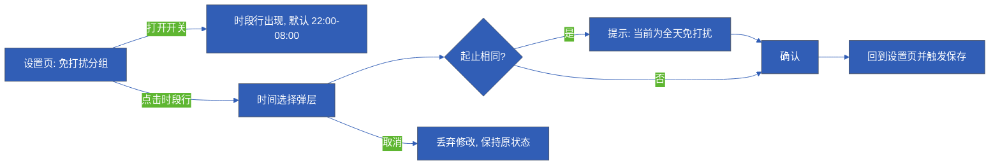

> **资料完整性提示：信息不充分**
> - 项目信息：项目名称、负责人、评审人、版本号、日期、所属端等均未提供
> - 版本记录：无历史版本、修订人、修订日期、变更说明
> - 原型：无原型截图或设计稿，仅有规格级页面元素描述，详细方案“原型”列无可用资产
> - 需求目标：只有功能达成判定方式，“主动消息投诉率”缺分子分母、统计周期、入口与基线，目标值待确认，不可验收
> - 需求背景：仅有测试材料中的定性陈述，无访谈、日志、投诉量或基线数据支撑影响程度
> - 页面状态补齐：加载中、拉取失败、保存中等状态属分析推断，未经确认，不能直接作为正式 PRD 规则
> - 待确认事项责任方：Q1–Q14 均未指派责任人与排期信息
> - 数据埋点：dnd_toggle 触发时机、dnd_save 字段格式、time_zone 格式未定；缺投诉类、主动问候曝光、拦截计数、用户或设备标识等事件，且不得表述为已上线
> - 术语范围：“两端”具体指哪两端未定义，双端同步规则范围不清
> - 视觉规范：仅有品牌主色 #315eb6，缺字号、间距、明暗模式、无障碍与多语言规格
> - 业务流程图与交互流程图：Mermaid 源码已给出，但未渲染，且部分节点（如未登录拦截时机、离线冲突合并）依赖待确认项

# PRD文档

> **资料不足提示（全文适用）**：本文输入为一份被标注为“软件QA人造测试材料”的方案分析（材料 id 0337035b-466d-4037-beeb-8dc579dc92f0），其中全部产品规则、页面范围、埋点字典的证据状态统一为**测试数据**，不是真实用户结论、不是已验收 PRD、不代表任何指标已达成。本文仅做归类、去重与编排，未做外部检索、未计算统计、未做产品决策。
>
> 缺失项：**项目信息、版本记录**完全缺失（材料未提供项目名称、负责人、评审人、版本号、日期、所属端与修订历史）；**无原型截图或设计稿**，详细方案“原型”列无可用资产；**无访谈、日志、投诉量与基线数据**，因此全文不含任何频次、比例、趋势数字；两张流程图为**仅源码、未渲染**状态；标注为“分析推断”的状态与元素为上游分析节点补充建议，**未经确认，不进入正式规则**。

## 项目信息

**材料不足。** 现有输入未提供以下任何字段，本文不自行拟定：

| 字段 | 现状 | 所需输入 |
| --- | --- | --- |
| 项目／需求名称 | 材料仅给出需求名“宠物免打扰设置” | 正式立项名称与项目编号 |
| 所属端 | 材料出现“双端同步”表述，但“两端”具体所指未定义（对应 Q4） | iOS／Android／桌面端等明确范围 |
| 产品负责人 | 缺失 | 责任人姓名与职责 |
| 设计负责人 | 缺失 | 界面稿与文案责任人 |
| 研发负责人 | 缺失 | 保存逻辑与埋点实现责任人 |
| 评审人与评审结论 | 缺失 | 评审记录 |
| 版本号与发布日期 | 缺失（见版本记录） | 版本命名规则与计划日期 |
| 关联系统 | 材料仅涉及设置页与时间弹层；推送系统重构明确为范围外 | 是否需要关联推送／会话系统文档 |

唯一可引用的视觉输入：品牌主色 **#315eb6**（测试数据，材料给定）；无字号、间距、明暗模式、无障碍与多语言规格（Q14）。

## 版本记录

**材料不足。** 无历史版本、修订人、修订日期与变更说明，不虚构版本行。

| 版本号 | 日期 | 修订人 | 变更说明 | 状态 |
| --- | --- | --- | --- | --- |
| 待补 | 待补 | 待补 | 待补 | 本文为基于测试数据的草案，未评审、未验收 |

## 需求背景

> 证据性质：以下均为测试材料内的定性陈述（**测试数据**），无访谈、日志、投诉量或基线数据；影响程度不可量化，本文不生成任何数字。

| 场景 | 问题 | 影响（定性） | 证据（性质） | 证据缺口 |
| --- | --- | --- | --- | --- |
| 用户在工作时使用应用 | 主动问候会在用户不希望被打断的时段直接出现 | 打断专注；用户唯一可用的规避方式是退出应用 | 测试材料陈述（测试数据） | 无访谈、无打断频次或投诉量、无基线 |
| 用户希望“只在某些时段安静” | 当前测试版本没有免打扰能力，主动问候全部直接展示 | 用户无法在保留应用的同时避免主动消息 | 材料“现有方案”段（测试数据） | 无竞品或替代方案对比材料 |
| 用户跨午夜需要安静（如 22:00–08:00） | 时段跨天，若按单日区间处理会出现非法区间 | 时段规则若不明确将无法实现 | 材料规则（测试数据） | 无 |

**缺失证据表（背景量化部分）**

| 待补内容 | 用途 | 状态 |
| --- | --- | --- |
| 用户访谈或问卷记录 | 验证“工作时段被打断”是否真实高频 | 缺失 |
| 主动问候下发日志与时段分布 | 判断免打扰默认时段是否合理 | 缺失 |
| 投诉量或退出行为数据 | 量化问题影响程度 | 缺失 |
| 竞品或替代方案对比 | 说明方案选择依据 | 缺失 |

## 需求目标

| 目标 | 判定方式／统计方式 | 分母／周期 | 基线 | 目标值 | 状态 |
| --- | --- | --- | --- | --- | --- |
| 用户可开启免打扰并设置每日时间段 | 开关状态与起止时段可保存，并在双端回读一致（功能达成判定） | 不适用（功能项） | 当前测试版本无该能力 | 待确认 | 待实现，未验证 |
| 观察主动消息投诉率 | 分子：投诉主动消息的次数或人数；分母：同期收到主动问候的用户数或消息条数（**均未定义**） | 待确认 | **缺失**（材料明确无基线） | 待基线确认 | 待验证，不可验收 |
| 降低工作时段被打断 | 未定义 | — | 缺失 | — | 证据不足，不入目标 |

说明：
- 当前只能给出“功能达成”的判定方式；“投诉率”仅作待验证观察指标，且现有埋点字典（dnd_toggle、dnd_save）无法计算该指标（Q1、Q3）。
- 全文不得表述为已达成或已验证。

## 需求概述

**一句话范围**：在应用设置内新增“宠物免打扰设置”，允许用户开启免打扰并设置每日一个时间段，期间仅阻止主动问候，不阻止用户主动聊天，不改变成长逻辑；仅包含两个界面单元。

| 编号 | 内容 | 证据状态 |
| --- | --- | --- |
| C1 | 需求名：宠物免打扰设置；本 PRD 只做该需求 | 测试数据（材料给定） |
| C2 | 页面只有设置页 P1 与时间选择弹层 P2 | 测试数据（材料给定） |
| C3 | 默认关闭免打扰 | 测试数据（材料给定） |
| C4 | 开启后默认时段 22:00–08:00 | 测试数据（材料给定） |
| C5 | 时段按设备当前时区解释，跨午夜合法 | 测试数据（材料给定） |
| C6 | 起止时间相同视为全天免打扰，并有明确提示 | 测试数据（材料给定） |
| C7 | 仅阻止主动问候，不阻止用户主动聊天 | 测试数据（材料给定） |
| C8 | 喂养成长不暂停 | 测试数据（材料给定） |
| C9 | 保存失败提示重试，并保留上次成功状态 | 测试数据（材料给定） |
| C10 | 未登录先登录 | 测试数据（材料给定） |
| C11 | 双端状态同步，冲突以服务端最近成功保存为准 | 测试数据（材料给定；两端定义见 Q4） |
| C12 | 离线可修改，显示待同步，恢复联网后提交 | 测试数据（材料给定） |
| C13 | 范围外：多时间段、按星期设置、推送系统重构 | 测试数据（材料给定） |
| C14 | 此外不含社区、商业模式、成长玩法改版 | 分析推断（范围收拢说明） |

## 业务流程图

> 图注：描述状态与数据流转（非用户操作路径）；源码为主题 base、主色 #315eb6。**当前未渲染，待宿主渲染**；无渲染器时以下方共享规则表（R1–R14）与状态表为准。

依赖待确认项的节点：未登录拦截时机（Q7）、离线与冲突的先后顺序与是否提示（Q8、E4/E5）、字段格式（Q5）。

## 交互流程图

> 图注：描述用户操作路径，与业务流程图不互相替代；**未渲染，待宿主渲染**。

依赖待确认项：时段行在关闭态是隐藏还是置灰（S2）、全天展示形态与文案（Q10）、取消行为（T4）、未登录拦截时机（Q7）。

## 详细方案

**原型状态声明**：本文无任何原型截图或设计稿，下方“原型”列一律为“无原型资产（材料不足）”，元素清单为规格级描述，布局、字号、间距、明暗模式待设计补充（Q14）。品牌主色 #315eb6（测试数据）。

### 模块总览（一屏一行）

| 一级模块 | 二级功能 | 原型 | 描述 |
| --- | --- | --- | --- |
| 免打扰设置（P1） | 免打扰开关控制 | 无原型资产（材料不足） | 二元开关，默认关闭；开启后启用默认时段 22:00–08:00；未登录先登录；保存失败保留上次成功状态并提示重试；离线可改并显示待同步 |
| 免打扰设置（P1） | 当前时段展示与入口 | 无原型资产（材料不足） | 开启后显示当前生效时段；点击进入时间选择弹层；起止相同时展示全天提示；展示时区说明与状态提示区 |
| 时间选择弹层（P2） | 起止时间选择 | 无原型资产（材料不足） | 小时与分钟选择，默认 22:00 与 08:00；跨午夜合法；时区只读；确认提交并触发保存，取消放弃修改 |
| 时间选择弹层（P2） | 全天提示 | 无原型资产（材料不足） | 起止完全一致时实时提示“当前为全天免打扰”，并保持可确认；文案与展示形态待确认（Q10） |

### P1 免打扰设置页 · 页面元素

| 编号 | 元素 | 说明 | 所属边界 | 证据状态 |
| --- | --- | --- | --- | --- |
| P1-E1 | 页面标题与返回 | 进入设置页的常规导航 | 本页 | 分析推断（导航形态待设计确认） |
| P1-E2 | “免打扰”分组标题 | 分组入口，说明该设置的作用 | 本页 | 分析推断（文案待定） |
| P1-E3 | 免打扰开关 | 二元开关，默认关闭（C3） | 本页 | 测试数据（C3） |
| P1-E4 | 时段行 | 开启后显示当前生效时段，默认 22:00–08:00（C4） | 本页 | 测试数据（C4） |
| P1-E5 | 全天提示文案 | 起止相同时明确提示当前为全天免打扰（C6） | 本页与 P2 共用 | 测试数据（C6），文案待定 |
| P1-E6 | 时区说明 | 说明时段按设备当前时区生效（C5） | 本页 | 测试数据（C5），展示形态待定 |
| P1-E7 | 状态提示区 | 展示“待同步”“保存失败”等状态 | 本页 | 测试数据（C9、C12），形态待定 |
| P1-E8 | 重试入口 | 保存失败时提供重试操作（C9） | 本页 | 测试数据（C9），重试方式见 Q9 |

### P1 页面状态（每个状态一屏一行）

| 状态 | 触发条件 | 页面表现 | 交互说明 | 异常与提示 | 证据状态 |
| --- | --- | --- | --- | --- | --- |
| S1 未登录 | 未登录用户进入 | 先完成登录再进入设置页 | 登录后回到设置入口 | 登录中断后回到原入口，不保留未提交修改；拦截时机见 Q7 | 测试数据（C10） |
| S2 已登录·关闭态（默认） | 首次进入或用户关闭 | 开关为关；时段行隐藏或置灰 | 打开开关即启用默认时段 22:00–08:00 | 无 | 测试数据（C3、C4），隐藏或置灰待确认 |
| S3 开启态·在线已保存 | 开关打开且保存成功 | 开关为开；时段行显示当前时段 | 点击时段行打开 P2 | 无 | 测试数据（C4） |
| S4 开启态·离线待同步 | 离线时修改（开关或时段） | 开关与时段显示本地新值；状态提示区显示“待同步” | 可继续修改；恢复联网后自动提交（C12） | 待同步期间不宣称已生效于服务端 | 测试数据（C12） |
| S5 保存中 | 提交保存请求 | 开关与时段显示目标值；状态提示区显示保存中 | 保存中重复操作的处理待确认 | 无 | **分析推断**（材料未规定） |
| S6 保存失败 | 保存返回失败 | 回退并保留上次成功状态 | 提供重试入口（C9） | 提示“保存失败，请重试”；重试方式与次数见 Q9 | 测试数据（C9） |
| S7 加载中 | 进入页面拉取服务端状态 | 展示骨架或占位 | 加载完成前不允许修改 | 无 | **分析推断**（材料未规定） |
| S8 拉取失败 | 拉取服务端状态失败 | 提示重试；不回退到本地臆测值 | 重试后重新拉取 | 与 S6 文案需区分 | **分析推断**（材料未规定） |

### P2 时间选择弹层 · 页面元素

| 编号 | 元素 | 说明 | 所属边界 | 证据状态 |
| --- | --- | --- | --- | --- |
| P2-E1 | 开始时间选择 | 小时与分钟选择，默认 22:00（C4） | 弹层 | 测试数据（C4） |
| P2-E2 | 结束时间选择 | 小时与分钟选择，默认 08:00（C4） | 弹层 | 测试数据（C4） |
| P2-E3 | 时区只读说明 | 显示按设备当前时区生效，不可在此修改时区（C5） | 弹层 | 测试数据（C5） |
| P2-E4 | 全天提示 | 起止相同时实时提示“当前为全天免打扰”（C6） | 弹层 | 测试数据（C6），文案待定 |
| P2-E5 | 确认与取消 | 确认提交并触发保存；取消放弃本次修改 | 弹层 | 测试数据（隐含于 C4、C9），按钮文案待定 |

### P2 状态与交互

| 状态 | 触发 | 表现与交互 | 异常 | 证据状态 |
| --- | --- | --- | --- | --- |
| T1 默认打开 | 从 S3／S4 点击时段行 | 带入当前生效时段，焦点落在开始时间 | 无 | 分析推断（带入值形态待确认） |
| T2 跨午夜区间 | 起止落在不同日（如 22:00–08:00） | 视为合法区间，不做非法校验，展示为“22:00–08:00” | 无 | 测试数据（C5） |
| T3 起止相同 | 起止小时分钟完全一致 | 提示当前为全天免打扰并保持可确认 | 提示文案与展示形态见 Q10 | 测试数据（C6） |
| T4 取消 | 点击取消或关闭弹层 | 丢弃本次修改，页面保持上次成功状态 | 无 | 测试数据（隐含），行为待确认 |
| T5 确认后保存失败 | 确认后提交失败 | 回到设置页并进入 S6 | 提示重试 | 测试数据（C9） |

### 跨页共享规则（集中定义，各屏复用）

| 编号 | 规则 | 说明 | 证据状态 |
| --- | --- | --- | --- |
| R1 | 默认关闭 | 无本地与服务端配置时，免打扰为关闭 | 测试数据（C3） |
| R2 | 默认时段 | 首次开启时生效 22:00–08:00 | 测试数据（C4） |
| R3 | 时区 | 时段一律按设备当前时区解释；存储需携带时区标识 | 测试数据（C5），格式见 Q5 |
| R4 | 跨午夜 | 结束时间早于开始时间视为跨午夜，合法 | 测试数据（C5） |
| R5 | 全天 | 起止相同视为全天免打扰，需明确提示 | 测试数据（C6） |
| R6 | 作用范围 | 免打扰只阻止主动问候展示；用户主动发起聊天不受影响 | 测试数据（C7） |
| R7 | 与成长的关系 | 免打扰期间喂养与成长逻辑不暂停、不改判 | 测试数据（C8） |
| R8 | 保存成功 | 以服务端返回的成功结果作为唯一生效依据 | 测试数据（C9、C11） |
| R9 | 保存失败 | 提示重试，并保留上次成功状态，不写入失败值 | 测试数据（C9） |
| R10 | 登录门槛 | 未登录先登录，登录后回到设置入口 | 测试数据（C10），时机见 Q7 |
| R11 | 双端同步 | 双端展示以服务端最近一次成功保存为准 | 测试数据（C11），两端定义见 Q4 |
| R12 | 冲突处理 | 冲突时服务端最近成功保存覆盖本地未提交值；是否提示见 Q8 | 测试数据（C11） |
| R13 | 离线 | 离线可修改并显示待同步；恢复联网后提交 | 测试数据（C12） |
| R14 | 范围外 | 不做多时间段、不做按星期、不做推送系统重构 | 测试数据（C13） |

### 异常清单（表现已见状态表，此处仅列触发与数据结果）

| 编号 | 异常或状态 | 触发条件 | 对应状态 | 数据结果 | 待确认点 |
| --- | --- | --- | --- | --- | --- |
| E1 | 未登录 | 未登录访问设置页 | S1 | 不产生保存 | Q7 拦截时机 |
| E2 | 保存失败 | 保存返回失败 | S6／T5 | 服务端状态不变 | Q9 重试方式 |
| E3 | 离线修改 | 无网络时修改 | S4 | 本地暂存，未提交 | 待同步期间多次修改的合并方式 |
| E4 | 联网后提交 | 恢复网络 | S4→S3／S6 | 提交最新本地值 | 与 E5 的先后顺序 |
| E5 | 双端冲突 | 另一端已成功保存 | S3／S4 | 本地值被覆盖 | Q8 是否提示 |
| E6 | 起止相同 | 用户选成同一时间 | T3 | 保存为全天语义 | Q10 展示形态 |
| E7 | 跨午夜 | 结束早于开始 | T2 | 合法区间 | 无 |
| E8 | 设备时区变更 | 系统时区变化 | 未定义 | 待确认 | Q11 |
| E9 | 加载或拉取失败 | 进入页面拉取失败 | S7／S8 | 不采用臆测值 | **分析推断**，需确认 |

## 数据埋点

> 以下事件与参数全部来自材料给定的埋点字典（**测试数据**）；**尚未上线，不得表述为已上线**。字段格式（Q5）与触发时机（Q6）未定，需补齐后再交研发。

| 事件 | 触发时机 | 参数 | 类型 | 取值 | 状态 |
| --- | --- | --- | --- | --- | --- |
| dnd_toggle | 用户切换免打扰开关时（切换即上报或保存成功后上报待确认，Q6） | enabled | boolean | true／false | 字典给定，未上线 |
| dnd_save | 保存免打扰时段后 | start_time | string | 格式待确认（Q5） | 字典给定，未上线 |
| dnd_save | 保存免打扰时段后 | end_time | string | 格式待确认（Q5） | 字典给定，未上线 |
| dnd_save | 保存免打扰时段后 | time_zone | string | 格式待确认，IANA 或偏移（Q5） | 字典给定，未上线 |
| dnd_save | 保存免打扰时段后 | result | 枚举 | success／fail | 字典给定，未上线 |

**埋点缺口（缺失证据表）**

| 缺口 | 影响 | 说明 |
| --- | --- | --- |
| 无投诉类事件 | 目标“主动消息投诉率”无法计算 | 需另行定义投诉上报事件与统计方式（Q1、Q3） |
| 无主动问候曝光或下发事件 | 无法确定投诉率分母 | 需确认是否复用既有推送或会话埋点，材料未提供 |
| 无免打扰生效期内的拦截计数 | 无法验证“仅阻止主动问候”的实际效果 | 材料未提供，不自行扩字段 |
| 无用户或设备标识字段 | 无法按端拆分同步问题 | 材料未提供，不自行扩字段 |

因缺上述事件与数据，本文不生成任何统计图、趋势或留存曲线。

## 待确认事项

| 编号 | 事项 | 影响 | 阻塞程度 | 责任方 |
| --- | --- | --- | --- | --- |
| Q1 | “主动消息投诉率”的统计方式：投诉入口、分子、分母（收到主动问候的用户数或消息条数）、统计周期、是否区分主动与被动 | 目标不可验收 | 高 | 待指派（人员未知） |
| Q2 | 目标值与基线（材料明确待基线确认） | 目标不可验收 | 高 | 待指派 |
| Q3 | 现有埋点字典无投诉类事件，指标无法由 dnd_toggle、dnd_save 计算；是否新增 | 指标无法计算 | 高 | 待指派 |
| Q4 | “两端”具体指哪两端（如 iOS／Android；移动端／桌面端） | 双端同步规则范围不清 | 中 | 待指派 |
| Q5 | start_time、end_time 传参格式（HH:mm 或带日期）与 time_zone 格式（IANA 或偏移） | 保存逻辑与埋点无法实现 | 高 | 待指派（研发） |
| Q6 | dnd_toggle 触发时机：切换即上报还是保存成功后上报 | “切换次数”统计口径歧义 | 中 | 待指派 |
| Q7 | 未登录判定时机：进入设置页即拦截，还是点击开关时拦截 | 首个页面状态不定 | 中 | 待指派 |
| Q8 | 离线期间另一端已成功保存、联网后本地提交被覆盖时，是否需显式提示用户 | 异常体验与文案不定 | 中 | 待指派 |
| Q9 | 保存失败的重试方式：手动、自动或两者；重试次数与超时 | 失败态规格不定 | 中 | 待指派 |
| Q10 | 全天（起止相同）的展示形态：显示“全天”还是“22:00–22:00”，并确定提示文案 | 文案不一致 | 低 | 待指派（设计） |
| Q11 | 设备时区变更后，已保存时段的解释与提示 | 跨时区一致性 | 中 | 待指派 |
| Q12 | 免打扰开启后是否需要在会话页提供可见状态标识 | 范围可能扩张 | 低 | 待指派 |
| Q13 | 人员、评审与验收责任方 | 无法排期与指派待办 | 高 | 待指派 |
| Q14 | 是否需要无障碍、多语言、暗色模式适配；字号、间距等视觉规格 | 视觉与文案规格不全 | 低 | 待指派（设计） |

**纳入建议（不构成产品决策，仅为编排说明）**：S5、S7、S8、E9、P1-E1、P1-E2、T1 均标注为“分析推断”，需确认后方可写入正式规则；Q1、Q2、Q3、Q5、Q13 关闭前，本 PRD 的目标章节只能保持“功能达成判定 ＋ 待验证观察指标”的表述。